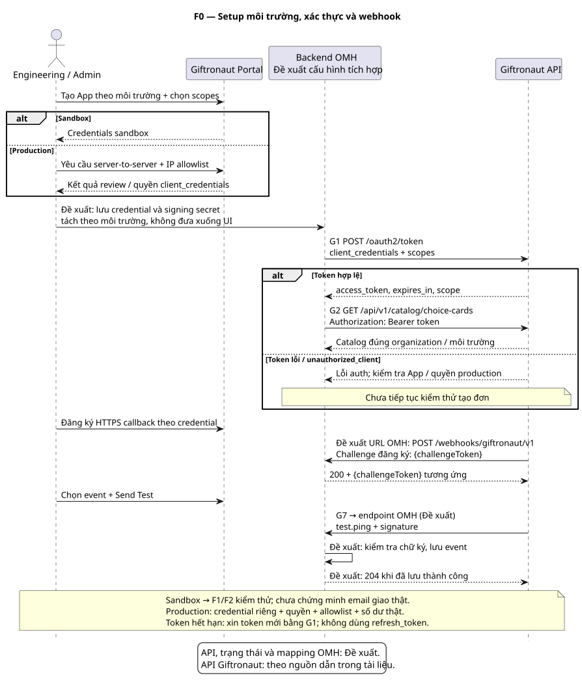
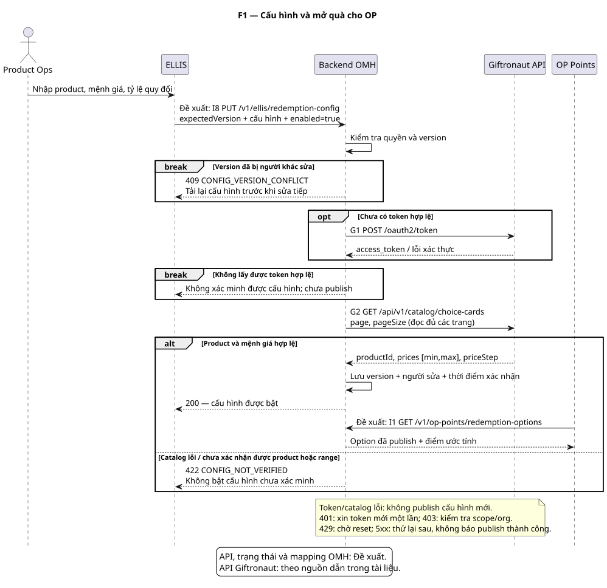
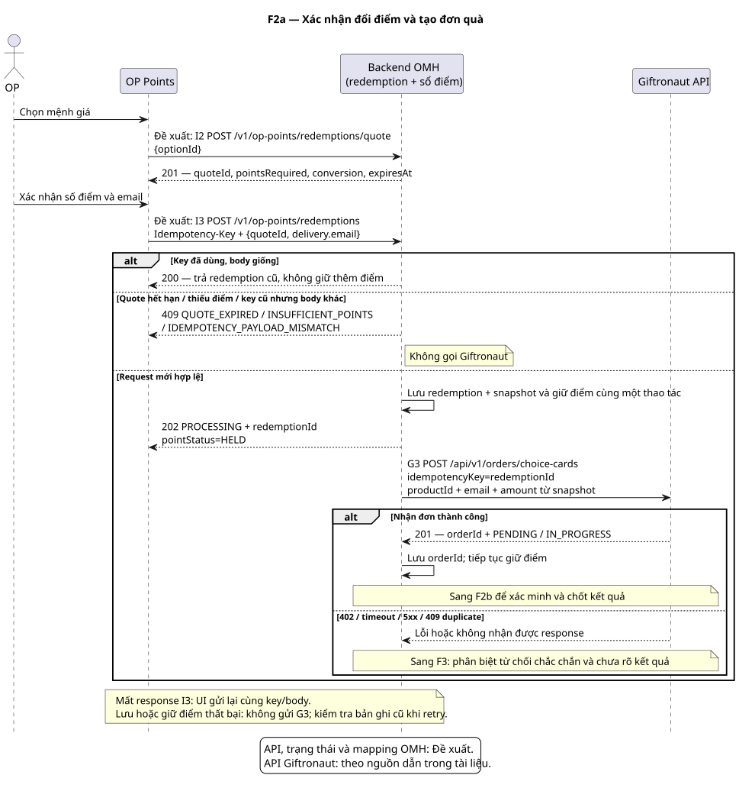
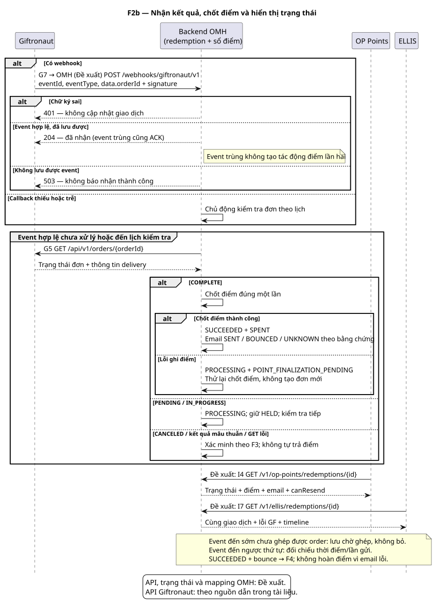
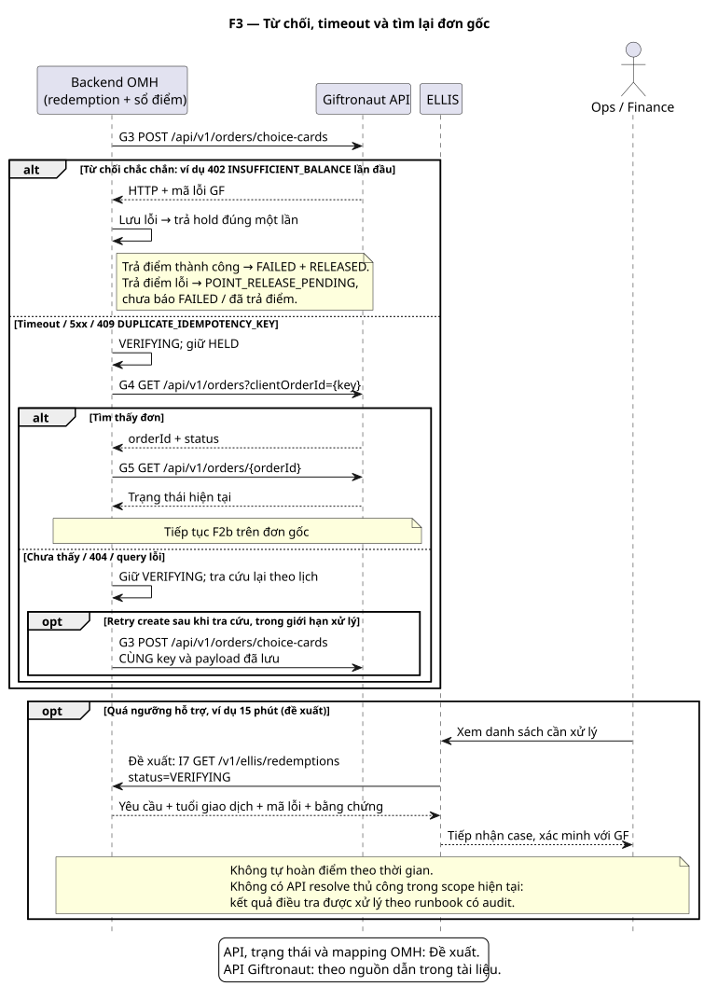
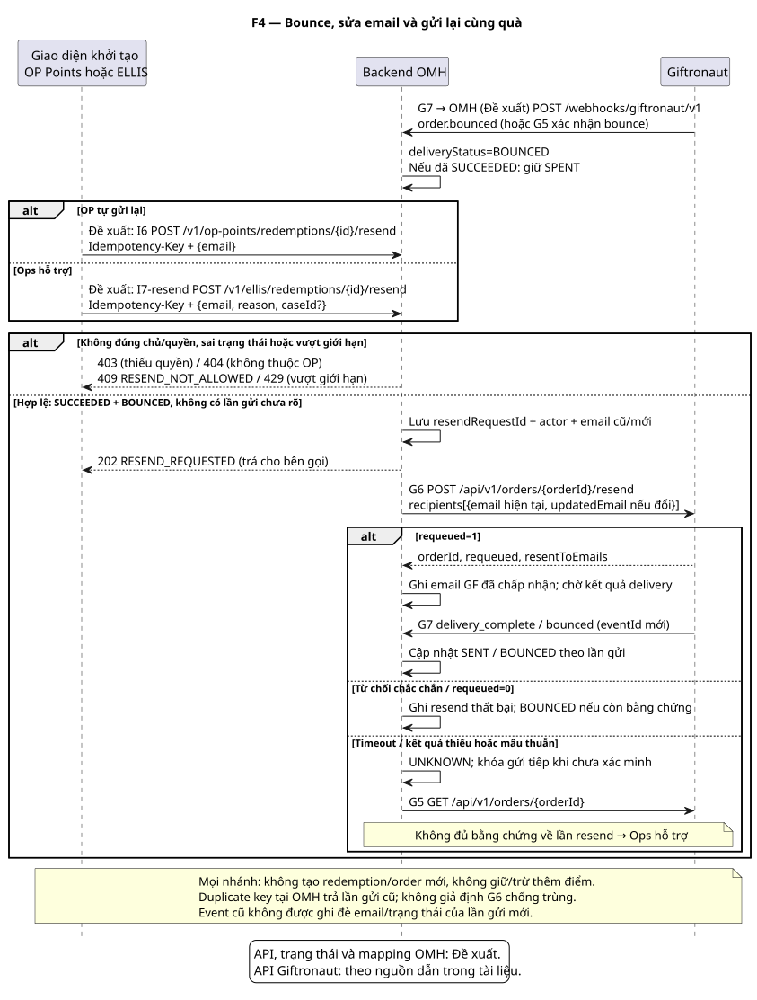
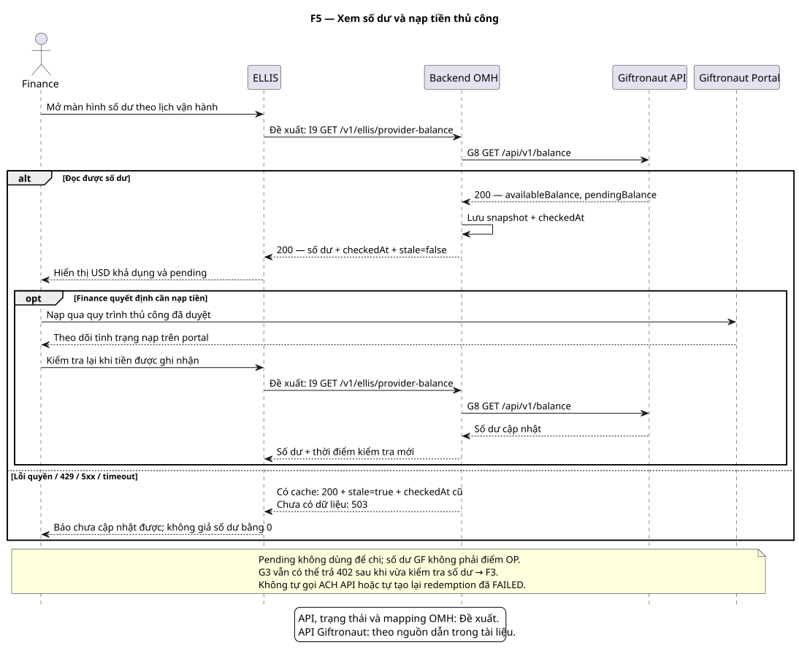
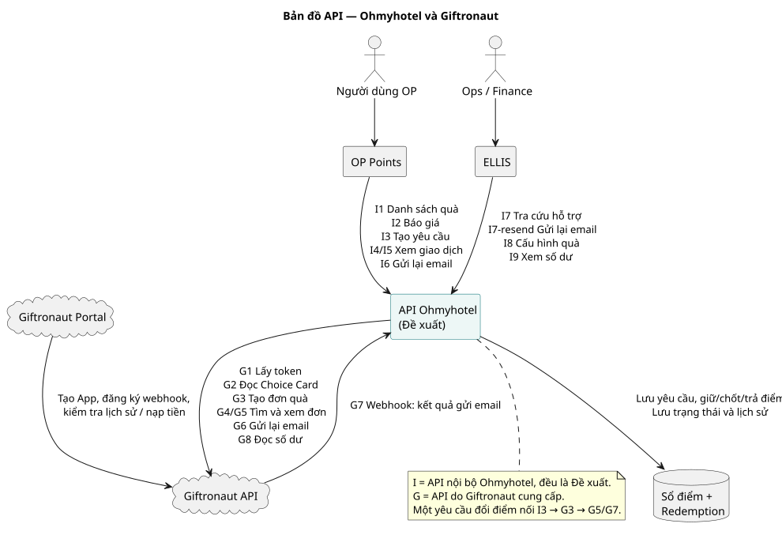
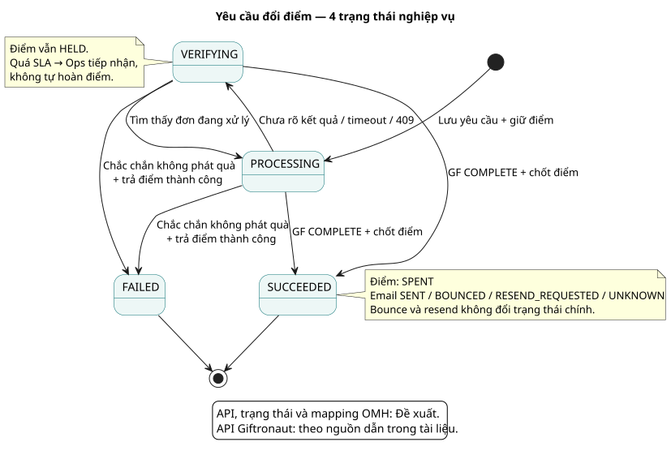

# Tích hợp Giftronaut — Đặc tả tích hợp cho OP Points & ELLIS

> **Luồng chính:** OP xác nhận đổi quà → Ohmyhotel tạo yêu cầu và giữ điểm → gọi Giftronaut tạo Choice Card → xác minh kết quả → chốt điểm và cập nhật email. Nếu chưa rõ kết quả, tiếp tục xác minh; chỉ trả điểm khi chắc chắn không phát quà.

| Thuộc tính | Nội dung |
|---|---|
| Phiên bản / cập nhật | 2.6 · 18/10/2026 — bổ sung rule BA cho vận hành quà, số dư và báo cáo |
| Mục đích | BA bàn giao flow, API, ngoại lệ, trạng thái và dữ liệu cho Dev/QA |
| Phạm vi | Một người nhận / yêu cầu; Choice Card; gửi ngay qua email; OP tự resend, ELLIS hỗ trợ |
| Cách đọc | Mục 1–2: nghiệp vụ; 3: API Giftronaut; 4: API nội bộ; 5: lỗi; 6: state machine; 7: dữ liệu; 8–9: nghiệm thu và điểm cần chốt |
| Quy ước | **[GF]** có trong tài liệu Giftronaut; **[OMH — Đề xuất]** contract/quy tắc đề xuất cho Ohmyhotel; **[CẦN CHỐT]** chưa đủ bằng chứng hoặc cần quyết định nghiệp vụ |
| Giới hạn bằng chứng | Đã đối chiếu tài liệu công khai; chưa gọi sandbox có credentials. Không khẳng định backend hiện tại đã có các API đề xuất |

### Cách gọi đơn giản trong tài liệu

| Từ trong tài liệu | Hiểu đơn giản |
|---|---|
| OP | Người dùng tích điểm và đổi quà trên OP Points |
| Ops | Nhân viên vận hành/hỗ trợ dùng ELLIS |
| Backend Ohmyhotel | Phần xử lý chạy trên server; giữ điểm, gọi Giftronaut và lưu kết quả. Người dùng không nhìn thấy phần này |
| Redemption | Một lần yêu cầu đổi điểm lấy quà; có mã `redemptionId` |
| Provider | Giftronaut, bên phát Choice Card |
| Hold điểm | Tạm khóa điểm để OP không dùng lại trong khi chờ kết quả |
| Chốt điểm | Trừ điểm vĩnh viễn sau khi Giftronaut xác nhận quà đã hoàn tất |
| Trả điểm | Mở lại điểm đã tạm khóa khi chắc chắn không có quà được phát |
| Mã chống trùng | Mã giúp bấm lại/retry không tạo thêm quà; trong API gọi là `Idempotency-Key` |
| I1, I2… | API nội bộ Ohmyhotel, đều là **Đề xuất**; bấm mã để tới spec |
| G1, G2… | API do Giftronaut cung cấp; bấm mã để tới spec và nguồn chính thức |

## 1. Phạm vi và quy tắc nghiệp vụ

| Hệ thống / vai trò | Trách nhiệm |
|---|---|
| OP Points | Chọn mệnh giá, xác nhận số điểm/email, tạo yêu cầu, xem lịch sử, gửi lại email khi bounce |
| Backend Ohmyhotel | Tạo redemption trước khi gọi đối tác; tính/giữ/chốt/trả điểm; gọi API; lưu kết quả và cập nhật trạng thái |
| Giftronaut | Tạo đơn Choice Card, xử lý gửi email, cung cấp kết quả và số dư tài khoản đối tác |
| ELLIS / Ops | Cấu hình quà, tra cứu và xử lý yêu cầu bị kẹt, hỗ trợ resend có lưu người thao tác |
| Finance | Kiểm tra số dư, nạp tiền thủ công qua portal, đối chiếu giao dịch |

**Baseline từ [OP Points BRD/PRD, mục 9](../../02-domain-specifications/op-points/OP-Points-BRD-PRD.md):** các lựa chọn 10/20/50/100 USD; điểm thuộc từng OP; không hủy đơn đổi đã gửi; email lỗi không đồng nghĩa phát quà thất bại. Mệnh giá, tỷ giá và mức tối thiểu trong prototype vẫn cần duyệt trước production.

Quy tắc bàn giao [OMH — Đề xuất]:

1. Một redemption chỉ gắn với một đơn Giftronaut. Bấm lại/retry không tạo quà hoặc trừ điểm lần hai.
2. Lưu yêu cầu và giữ điểm thành công **trước** khi gửi đơn sang Giftronaut. Không đủ điểm thì không gọi đối tác.
3. `COMPLETE` được dùng để chốt điểm; email thành công/bounce được theo dõi riêng. Không coi `201 Created` là đã gửi quà.
4. Timeout hoặc lỗi chưa rõ kết quả: giữ điểm, tra cứu đơn cũ. Không tự trả điểm theo thời gian hết hạn.
5. Chỉ trả phần điểm đang giữ khi chắc chắn không có quà được phát; không tự hoàn điểm sau khi đã chốt.
6. Resend dùng cùng order, không tạo redemption mới và không trừ thêm điểm.
7. Backend tính điểm theo cấu hình được duyệt, lưu tỷ lệ tại lúc xác nhận; đổi cấu hình sau đó không làm đổi giao dịch cũ.

### 1.1. Quy tắc vận hành bổ sung cho quà, số dư và báo cáo

Các quy tắc dưới đây là **[OMH — Đề xuất]** để xử lý các tình huống vận hành đã được nêu ra. Chúng không khẳng định Giftronaut đã cung cấp dữ liệu tương ứng; các điểm cần xác nhận với Giftronaut/PO được ghi rõ ở mục 9.

| Chủ đề | Quy tắc nghiệp vụ đề xuất | Điều người dùng/Ops thấy | Dữ liệu hoặc quyết định cần có |
|---|---|---|---|
| Quốc gia, mệnh giá và lựa chọn quà | Chỉ bật một option khi Ops đã xác nhận Choice Card và các lựa chọn người nhận có thể dùng tại thị trường mục tiêu. Nếu chưa có xác nhận, không hiển thị option cho OP thuộc thị trường đó. Không suy đoán quốc gia chỉ từ email; dùng country trong hồ sơ OP khi hồ sơ có dữ liệu đáng tin cậy. | OP chỉ thấy quà đã được phép đổi. Nếu thị trường chưa hỗ trợ, hiển thị “Quà này hiện chưa khả dụng tại khu vực của bạn”, không giữ điểm. | Ops lưu thị trường được phép, mệnh giá và ngày xác nhận; PO chốt có cho phép đổi khi chưa xác nhận được lựa chọn phù hợp hay không. |
| Hạn mức tổng giá trị quà | Trước khi có quota chính thức từ Giftronaut, OMH không tự đặt hạn mức ngày/tháng để từ chối OP. ELLIS theo dõi tổng USD quà đã phát hành theo ngày/tháng. Nếu Giftronaut từ chối chắc chắn vì quota/số dư, trả điểm đang giữ và hiển thị lý do an toàn cho OP. | Ops/Finance thấy số đã phát hành và các đơn bị từ chối. OP không bị giữ điểm khi đơn bị từ chối chắc chắn. | Giftronaut cần xác nhận quota, mã lỗi và phạm vi áp dụng; PO/Finance quyết định có đặt hạn mức nội bộ sau khi có thông tin này. |
| Cảnh báo số dư thấp | ELLIS hiển thị cảnh báo cho Finance/Ops khi `availableBalance` thấp hơn ngưỡng đã duyệt. Đề xuất mặc định pilot: bằng hai lần mệnh giá nhỏ nhất đang bật; Finance có thể thay đổi ngưỡng theo quy trình vận hành. `pendingBalance` không tính vào ngưỡng. | Cảnh báo “Số dư thấp — cần nạp tài khoản Giftronaut”, kèm số dư và thời điểm kiểm tra. Cảnh báo tự mất khi số dư mới đạt/vượt ngưỡng. | Ngưỡng, người nhận cảnh báo và lịch kiểm tra do Finance/Ops chốt. Không giả định có webhook số dư nếu Giftronaut chưa xác nhận. |
| Tổng USD đã phát hành và đối soát | Chỉ cộng các redemption đã `SUCCEEDED` và có giá trị provider xác nhận. Không cộng `PROCESSING`, `VERIFYING` hoặc `FAILED`. Báo cáo phải luôn có khoảng thời gian; mặc định là khoảng thời gian người dùng chọn, không phải “từ trước đến nay”. | ELLIS ghi rõ “Tổng USD quà đã phát hành trong kỳ”. Finance có thể đối chiếu từng dòng với order Giftronaut. | Cần chốt nguồn giá trị thực trả khi API không trả `providerTotalCost`, và chu kỳ đối soát, đề xuất hằng ngày trong pilot. |
| Hạn dùng và trạng thái đã sử dụng | Ngày hết hạn chỉ hiển thị khi nhận được từ Giftronaut hoặc điều kiện quà đã được Product phê duyệt. Nếu chưa có dữ liệu usage đáng tin cậy, hiển thị `Đã sử dụng: Chưa rõ`; không kết luận quà chưa dùng. Thống kê sắp hết hạn/hết hạn chỉ phản ánh hạn dùng, không khẳng định usage. | Audit log phân biệt rõ “sắp hết hạn”, “đã hết hạn” và “trạng thái sử dụng chưa rõ”. | Giftronaut xác nhận field expiry và khả năng cung cấp usage/event `recipient.redeemed`; PO chốt cách tính các chỉ số trên báo cáo. |

Ngoài phạm vi lần này: branded card tùy chỉnh, nhiều người nhận, gửi theo lịch, hủy đơn, ACH API và đối soát tự động nâng cao. Kiểm tra giao dịch thủ công hằng ngày vẫn cần trong pilot. Không cần gọi API tạo recipient riêng vì thông tin người nhận nằm ngay trong create order.

## 2. Các flow và thứ tự gọi API

Mã **G** là API Giftronaut ở mục 3; mã **I** là API nội bộ ở mục 4. Token hợp lệ được tái sử dụng, không cần xin mới trong mọi bước.

**Cách đọc sơ đồ:** mỗi cột là một hệ thống tham gia; mũi tên ghi mã API + method/path; khung `alt/else` là các nhánh kết quả, `opt` là bước chỉ chạy khi đủ điều kiện. Backend OMH bao gồm xử lý redemption và sổ điểm ở mức nghiệp vụ; sơ đồ không yêu cầu tách thành nhiều service. Host và payload đầy đủ xem mục 3–4.

| Flow | Khi bắt đầu | Hệ thống tham gia | Kết quả / flow tiếp theo |
|---|---|---|---|
| F0 — Setup & auth | Chuẩn bị sandbox hoặc production | Engineering → GF Portal; Backend OMH ↔ GF API | Credentials, token, callback và kiểm thử sẵn sàng |
| F1 — Cấu hình quà | Ops mở/bật cấu hình đổi quà | ELLIS → Backend OMH ↔ Giftronaut API; OP Points đọc option | Quà được publish hoặc trả lỗi cấu hình |
| F2a — Tạo yêu cầu | OP xác nhận đổi điểm | OP Points → Backend OMH → Giftronaut API | Yêu cầu đã lưu, giữ điểm, có order; sang F2b hoặc F3 |
| F2b — Hoàn tất | Có webhook hoặc tới lịch kiểm tra | Giftronaut ↔ Backend OMH; OP Points/ELLIS xem kết quả | Chốt điểm và trạng thái; bounce sang F4 |
| F3 — Xác minh/lỗi | Create bị từ chối hoặc không rõ kết quả | Backend OMH ↔ Giftronaut API; ELLIS cho Ops/Finance xử lý | Dùng đơn gốc, tiếp tục xác minh hoặc trả điểm khi đủ bằng chứng |
| F4 — Resend | Quà đã phát nhưng email bounce | OP Points **hoặc** ELLIS → Backend OMH ↔ Giftronaut | Gửi lại cùng quà; cập nhật email, không trừ thêm điểm |
| F5 — Số dư | Finance kiểm tra theo lịch | ELLIS → Backend OMH → Giftronaut API; Finance dùng GF Portal | Hiển thị số dư hoặc dữ liệu cũ có cảnh báo; nạp thủ công |

Bản đồ tổng quan cho phép bấm vào từng bước để tới flow tương ứng. Trong HTML, sơ đồ nằm bên trái; giải thích và ví dụ nằm bên phải, có thể bấm để đóng/mở. Các thao tác/API/mapping OMH đều là **Đề xuất**; API GF dẫn tới nguồn chính thức.

[Mở bản đồ tương tác trong HTML](OP-POINTS-ELLIS-GIFTRONAUT-INTEGRATION-BRD-PRD.html#integration-map)

### F0. Setup môi trường, sandbox và authentication

**Người khởi tạo:** Engineering/Admin. **Kết quả cần có:** môi trường được nhận diện đúng, token dùng được, webhook đã đăng ký và bộ dữ liệu kiểm thử riêng. Cấu hình/lưu trữ bên OMH dưới đây là **Đề xuất**.



[Mở ảnh PNG](assets/24-environment-auth.png) · [PlantUML source](diagrams/24-environment-auth.puml)

| Bước | Hệ thống / API | Kết quả |
|---|---|---|
| 1. Tạo App | Admin → Giftronaut Portal, chọn Sandbox | Credentials riêng; chọn orders.read, orders.write, catalog.read, balance.read |
| 2. Cấu hình kết nối | Backend OMH — **Đề xuất** | Lưu environment, organization/app reference, client ID/secret, webhook URL/signing secret, không đưa secret xuống OP Points/ELLIS |
| 3. Lấy token | G1 `POST https://api.giftronaut.com/oauth2/token` | Client Credentials → access_token, expires_in, scope; không dùng token đăng nhập OP để gọi GF |
| 4. Kiểm tra quyền | G2 catalog; G8 balance | Xác nhận truy cập đúng dữ liệu môi trường; chưa gọi tạo đơn nếu auth chưa đạt |
| 5. Đăng ký callback | Portal → HTTPS endpoint OMH **Đề xuất:** `/webhooks/giftronaut/v1` | Nhận challengeToken, trả 200 với cùng token để xác minh đăng ký |
| 6. Kiểm tra event | Portal Send Test → G7 | Kiểm tra chữ ký test.ping; event hợp lệ được lưu và ACK; test.ping không cập nhật redemption |
| 7. Kiểm thử nghiệp vụ | F1 → F2a → F2b, F3/F4 theo khả năng sandbox | Ghi request/response đã che secret; kiểm tra một lần giữ/chốt điểm, duplicate, timeout và callback |
| 8. Chuẩn bị production | App Production riêng; GF duyệt server-to-server và IP allowlist | Đổi cấu hình credential, callback và dữ liệu riêng; xác nhận quyền, tiền thật và checklist trước khi bật đổi quà |

Nguồn GF: [Sandbox & Production](https://api.giftronaut.com/docs/guides/sandbox), [Authentication](https://api.giftronaut.com/docs/guides/authentication), [Webhook setup](https://api.giftronaut.com/docs/guides/webhooks).

**Khác biệt cần nhớ:** cùng host API nhưng credential quyết định môi trường. Sandbox dùng tiền ảo và không gửi email thật; production có tác động thật. Không lấy kết quả sandbox làm bằng chứng giao email thật. Production Client Credentials cần được GF duyệt; `unauthorized_client` có thể xuất hiện trước khi được cấp quyền, IP ngoài allowlist có thể bị 403. Nguồn: [Sandbox & Production](https://api.giftronaut.com/docs/guides/sandbox).

**Đề xuất vận hành token OMH:** dùng expires_in để biết hạn; trước khi hết hạn xin token mới bằng G1. Business API trả 401 thì xin token mới và thử lại tối đa một lần, giữ nguyên key/body nếu là create. Client Credentials không dùng refresh_token. Nếu 403, kiểm tra scope, organization và IP allowlist thay vì liên tục xin token. Nguồn auth: [Authentication](https://api.giftronaut.com/docs/guides/authentication).

| Edge case | Xử lý / điều kiện hoàn tất |
|---|---|
| App production chưa được duyệt | Kiểm tra trạng thái server-to-server trên portal; chưa bật đổi quà |
| Sai secret / thiếu scope / sai môi trường | Sửa cấu hình đúng App; không đổi credential tùy ý để tìm order cũ |
| Challenge không thành công | Kiểm tra public HTTPS và response echo; chưa coi webhook là hoạt động |
| Challenge và business event khác envelope | OMH **Đề xuất** phân biệt bước đăng ký với event; challenge không chứa eventId, không đưa vào xử lý điểm. Cách xác thực challenge cần xác nhận với GF, không tự bỏ kiểm tra chữ ký cho mọi request |
| Signing secret sai | Event bị từ chối; cập nhật đúng secret môi trường rồi Send Test lại |
| Cần test bounce/402 nhưng sandbox không tái hiện | QA **Đề xuất** dùng mock có ghi nhãn để kiểm tra nhánh lỗi; xác nhận hành vi thật với GF trước nghiệm thu production |
| Mất callback | Tiếp tục F2b qua G5; xem Delivery History trên portal |

**Ví dụ:** Engineering tạo App sandbox, cấu hình backend test riêng, lấy token và gọi G2 thành công. GF gửi challenge `abc-test` → OMH trả `{"challengeToken":"abc-test"}`; Send Test được ACK nhưng không trừ điểm. Sau đó mới chạy đổi 20 USD bằng dữ liệu demo. Trước production phải làm lại cấu hình App/quyền/callback cho môi trường thật.

### F1. Chuẩn bị quà để cho phép đổi

**Người khởi tạo:** Product Ops trên ELLIS. **Điều kiện:** có quyền cấu hình; credential GF được cấp; thông số quy đổi được duyệt. **Kết thúc:** cấu hình được publish hoặc giữ nguyên cấu hình đang có và báo lý do chưa cập nhật được.



[Mở ảnh PNG](assets/18-ba-setup.png) · [PlantUML source](diagrams/18-ba-setup.puml)

| Bước | Ai gọi / thao tác | API | Kết quả cần có |
|---|---|---|---|
| 1 | Backend lấy token | G1 | Token có quyền catalog/order/balance tương ứng |
| 2 | Backend đọc Choice Card | G2 | `productId`, khoảng giá và bước giá hợp lệ cho organization |
| 3 | Ops cấu hình; Finance/Product duyệt | I8 | Mệnh giá OMH nằm trong khoảng GF; tỷ giá, giá trị 1P, điểm tối thiểu, email template, phiên bản policy |
| 4 | OP mở trang đổi điểm | I1 | Chỉ hiện option đã publish; không gọi catalog GF trực tiếp từ browser |

Không publish khi catalog lỗi hoặc chưa xác nhận product/mệnh giá. Catalog được kiểm tra lúc cấu hình và định kỳ; không phải một bước bắt buộc của mỗi lần đổi.

Trước khi publish, Ops ghi nhận thêm thị trường được phép đổi và ngày xác nhận khả dụng. Nếu không có xác nhận rằng người nhận ở một thị trường có thể dùng quà, option đó không được mở cho OP ở thị trường này. Đây là rule nghiệp vụ của OMH; cần xác nhận danh sách quốc gia/lựa chọn thực tế với Giftronaut.

| Edge case | Phát hiện tại API | Hệ thống xử lý / kết quả |
|---|---|---|
| Hai Ops cùng sửa cấu hình | I8 **Đề xuất:** `PUT /v1/ellis/redemption-config` | Backend trả `409 CONFIG_VERSION_CONFLICT`; ELLIS tải lại bằng I8 GET; không ghi đè bản mới |
| Product không có hoặc mệnh giá ngoài range | G2 `GET /api/v1/catalog/choice-cards` khi xử lý I8 | Backend không bật cấu hình, trả `422 CONFIG_NOT_VERIFIED`; Ops sửa product/mệnh giá |
| Chưa xác nhận khả dụng tại thị trường OP | I8 **Đề xuất:** kiểm tra cấu hình thị trường đã duyệt | Không publish cho thị trường đó; ELLIS nêu rõ cần Ops/Giftronaut xác nhận, không giữ điểm của OP |
| Token sai / thiếu scope / GF tạm lỗi | G1 hoặc G2 | Backend xử lý E02/E03/E07/E08; ELLIS thấy chưa xác minh, không báo publish thành công |

**Ví dụ:** Ops chọn product `55`, cấu hình 20 USD và tỷ lệ demo 1.480 KRW/USD, 1.000 KRW/P. Nếu G2 xác nhận range chứa 20 USD, I8 (**Đề xuất**) lưu version mới và I1 (**Đề xuất**) hiển thị quà. Nếu người khác vừa sửa cùng version, ELLIS nhận 409 và tải lại cấu hình.

### F2. OP đổi điểm — luồng chính

#### F2a. Tạo yêu cầu nội bộ rồi mới tạo đơn Giftronaut

**Người khởi tạo:** OP trên OP Points. **Điều kiện:** option đã publish; OP được đổi điểm. **Dữ liệu đi qua flow:** option → quote → redemption → provider order. `redemptionId` gắn xuyên suốt việc giữ điểm và `idempotencyKey` gửi GF.



[Mở ảnh PNG](assets/19-ba-create.png) · [PlantUML source](diagrams/19-ba-create.puml)

| Bước | Ai gọi / thao tác | API | Dữ liệu và kết quả |
|---|---|---|---|
| 1 | OP chọn quà, lấy báo giá | I2 | Gửi option; nhận `quoteId`, điểm cần dùng, tỷ lệ, thời hạn quote |
| 2 | OP xác nhận email và số điểm | I3 | Gửi `quoteId`, email, khóa chống trùng |
| 3 | Backend kiểm tra và lưu | Xử lý nội bộ | Xác định OP/company từ đăng nhập; kiểm tra quote/quyền/số dư; tạo `redemptionId` + giữ điểm cùng một thao tác; trả `202 PROCESSING` |
| 4 | Backend đặt quà | G3 | Dùng `redemptionId` làm `idempotencyKey`, product/mệnh giá/email từ dữ liệu đã lưu |
| 5 | GF trả đơn đã nhận | Response G3 | Lưu `orderId`, `status`; `PENDING/IN_PROGRESS` vẫn giữ điểm |
| 6 | GF báo kết quả; backend xác minh | G7 → G5 | Nhận webhook rồi đọc trạng thái đơn; nếu không có webhook thì backend chủ động G5 |
| 7 | Backend chốt kết quả | Xử lý nội bộ | `COMPLETE`: chốt điểm đúng một lần → `SUCCEEDED`; lưu trạng thái email riêng |
| 8 | OP/ELLIS xem tiến độ | I4 / I7 | Đọc cùng redemption; UI không tự quyết định trạng thái |

Nếu provider từ chối chắc chắn ở bước 4, đi F3 và trả điểm. Nếu chốt điểm nội bộ lỗi sau khi GF đã COMPLETE, giữ `PROCESSING`, chuyển Ops xử lý; không tạo đơn GF mới.

| Edge case trước/sau submit | API liên quan | Xử lý và điều OP thấy |
|---|---|---|
| Quote hết hạn | I3 trả `409 QUOTE_EXPIRED` → I2 lấy quote mới | OP xác nhận lại số điểm; chưa giữ điểm, chưa gọi G3 |
| Điểm vừa được dùng bởi yêu cầu khác | I3 trả `409 INSUFFICIENT_POINTS` | Backend không giữ thêm điểm; UI hiển thị số dư mới |
| Double click / client mất response | Gọi lại I3 cùng key/body | Trả redemption cũ; không gọi G3 lần nữa do thao tác UI |
| Cùng key nhưng đổi email/quote | I3 trả `409 IDEMPOTENCY_PAYLOAD_MISMATCH` | Không tạo yêu cầu mới; UI dùng lại request gốc hoặc bắt đầu ý định đổi mới hợp lệ |
| Quote đã dùng với key khác | I3 trả `409 QUOTE_ALREADY_USED` | Mở yêu cầu cũ; không giữ điểm lần hai |
| Lưu yêu cầu/giữ điểm lỗi | I3 lỗi nội bộ | Không gửi G3 trước khi lưu/giữ thành công; retry kiểm tra lại record cũ |
| GF 402, 409, timeout hoặc 5xx | G3 | Đi F3; OP tiếp tục xem I4, không tự bấm tạo đơn thay thế |

**Ví dụ:** OP có 50P; quote demo 20 USD cần 29,6P. I3 (**Đề xuất**) tạo `rdm_001`, giữ 29,6P, còn 20,4P khả dụng. G3 gửi key `rdm_001`; OP bấm lại cùng key thì vẫn nhận một yêu cầu. Chưa có COMPLETE thì chưa chốt điểm.

#### F2b. Nhận callback hoặc chủ động hỏi kết quả, rồi chốt điểm

**Bên kích hoạt:** Giftronaut gọi webhook hoặc backend đến lịch kiểm tra. **Điều kiện:** có redemption đang xử lý; có orderId để gọi G5. Nếu chưa có orderId thì dùng F3/G4 trước. **Kết thúc:** SUCCEEDED sau khi chốt điểm, hoặc giữ trạng thái xử lý/xác minh cùng lý do.



[Mở ảnh PNG](assets/20-ba-completion.png) · [PlantUML source](diagrams/20-ba-completion.puml)

| Nhánh | API / thứ tự | Hành động và điểm |
|---|---|---|
| Callback hợp lệ | G7 **Đề xuất:** `POST /webhooks/giftronaut/v1` → G5 `GET /api/v1/orders/{orderId}` | Lưu event rồi xác minh đơn; COMPLETE mới chốt điểm |
| Callback không đến | Backend chủ động G5 | Xử lý cùng quy tắc như có webhook; không tạo order mới |
| Sai chữ ký / không lưu được | G7 trả 401 / 503 | Không cập nhật điểm; 503 không được coi là đã nhận thành công |
| Callback trùng | G7 trả 204 | Không xử lý lại tác động điểm; không suy ra có thêm một lần phát quà |
| Callback đến trước response create | G7 lưu event; ghép khi có orderId hoặc sau G4 | Giữ event chờ xử lý, không bỏ chỉ vì chưa tìm thấy redemption |
| G5 vẫn PENDING/IN_PROGRESS | Tiếp tục G5 theo lịch | HELD, OP thấy đang xử lý |
| G5 COMPLETE nhưng chốt điểm nội bộ lỗi | Retry thao tác chốt trên cùng redemption | `POINT_FINALIZATION_PENDING`; không gửi G3 lại |
| COMPLETE nhưng email bounce | G5/G7 → I4/I7 hiển thị kết quả | SUCCEEDED + SPENT + BOUNCED; cho đi F4 |
| Callback cũ/mâu thuẫn hoặc G5 lỗi | G5 xác minh + lưu case nếu chưa giải được | Không lùi trạng thái cuối hoặc tự hoàn điểm; áp dụng F3/mục 5 |

Sau xử lý, OP Points gọi I4 **Đề xuất:** `GET /v1/op-points/redemptions/{id}`; ELLIS gọi I7 **Đề xuất:** `GET /v1/ellis/redemptions/{id}`. Cả hai đọc cùng bản ghi, ELLIS có thêm lỗi GF và timeline theo quyền.

**Ví dụ:** G7 báo delivery_complete cho `OT_001`; G5 trả COMPLETE. Backend chốt 29,6P một lần, lưu SUCCEEDED + SENT. Nếu cùng eventId đến lại, trả ACK nhưng không chốt thêm. Nếu ghi sổ điểm lỗi, tiếp tục PROCESSING và xử lý lại chốt điểm trên cùng yêu cầu. Đây là mapping OMH **Đề xuất**.

### F3. Lỗi hoặc chưa rõ đơn đã tạo hay chưa

**Bên kích hoạt:** Backend nhận lỗi/mất response G3 hoặc không xác minh được đơn. **Hệ thống:** Backend OMH và GF trao đổi API; ELLIS phục vụ Ops/Finance khi cần can thiệp. **Điểm quyết định:** có bằng chứng “không phát quà” hay chỉ “chưa biết kết quả”.



[Mở ảnh PNG](assets/21-ba-recovery.png) · [PlantUML source](diagrams/21-ba-recovery.puml)

| Tình huống | Thứ tự xử lý [OMH — Đề xuất] | Điểm / kết quả |
|---|---|---|
| Bị từ chối trước khi gọi GF | I3 trả lỗi validation/quyền/số dư | Không giữ điểm; không tạo redemption thành công |
| GF từ chối chắc chắn, ví dụ lần gọi đầu trả 402 | Lưu lỗi → trả điểm → đánh dấu `FAILED` | Điểm về khả dụng; OP có thể tạo yêu cầu mới sau khi vấn đề được xử lý |
| Timeout, 5xx, mất response hoặc 409 duplicate | Đặt `VERIFYING` → G4 theo khóa đã lưu → có đơn thì G5 | Giữ điểm; dùng đơn cũ |
| G4 chưa thấy đơn | Tiếp tục tra cứu; nếu retry G3 thì giữ nguyên key **và payload** | Một kết quả rỗng/404 không đủ để hoàn điểm |
| Có `orderId` nhưng callback chậm | G5 → cập nhật theo trạng thái thực | Không cần gọi G3 lại |
| Quá thời gian xác minh | Đưa vào danh sách ELLIS cần hỗ trợ; Ops xác nhận với GF | Vẫn giữ điểm; chỉ chuyển `FAILED` khi có bằng chứng không phát quà |

**Đề xuất thời gian:** kiểm tra sau 30 giây, sau đó mỗi 60 giây trong 15 phút, có điều chỉnh theo rate-limit toàn hệ thống. Quá 15 phút cần Ops tiếp nhận; đây là ngưỡng hỗ trợ, không phải thời điểm tự hoàn điểm. Mức thời gian/SLA cần chốt tại mục 9.

**Chuỗi API tra cứu cụ thể:** G4 `GET /api/v1/orders?clientOrderId={redemptionId}` → lấy `orderId` → G5 `GET /api/v1/orders/{orderId}`. Nếu đã biết orderId thì gọi thẳng G5. Một lần query rỗng, 404 hay lỗi query không phải bằng chứng để trả điểm.

| Edge case | Bên xử lý | Quyết định |
|---|---|---|
| 402 nhận được sau một lần create trước đó đã timeout | Backend → G4/G5 | Phải xác minh lần trước; không áp dụng “402 là hoàn ngay” |
| 401 khi query/create | Backend → G1 rồi gọi lại API tương ứng tối đa một lần | Giữ key/body; nếu vẫn lỗi thì Engineering kiểm tra credentials |
| 403 thiếu scope/org | Backend / Engineering | Dừng retry tự động; không dùng credential khác môi trường để tìm đơn |
| 429 trong khi xác minh | Backend | Đợi reset rồi gọi lại; điểm vẫn HELD |
| Tìm thấy nhiều đơn bất thường | Backend / Ops | Không tự chọn đơn hoặc phát thêm quà; tạo case có bằng chứng |
| Đã xác nhận không phát quà nhưng release lỗi | Backend | Retry trả hold cùng redemption; chưa hiển thị FAILED/đã trả điểm |
| Hết ngưỡng hỗ trợ vẫn chưa rõ | Ops xem I7 trên ELLIS, xác minh với GF theo runbook | Giao dịch giữ VERIFYING; chưa bổ sung API manual-resolve trong phạm vi spec này |

**Ví dụ:** G3 đã tạo `OT_001` nhưng response timeout. Backend giữ 29,6P ở VERIFYING và gọi G4 với `clientOrderId=rdm_001`; tìm thấy `OT_001` thì tiếp tục G5/F2b. Nếu lần gọi đầu bị từ chối chắc chắn vì 402, trả đúng 29,6P rồi FAILED. Không đổi key để thử phát quà mới. Mapping trạng thái/điểm OMH là **Đề xuất**.

### F4. Email bounce và gửi lại

**Người khởi tạo:** OP trên OP Points hoặc Ops trên ELLIS. **Điều kiện:** redemption SUCCEEDED, email BOUNCED, đúng quyền, chưa có lần gửi lại đang xử lý/chưa rõ kết quả. **Kết thúc:** email được gửi lại hoặc có lỗi hỗ trợ; trạng thái phát quà và điểm không thay đổi.



[Mở ảnh PNG](assets/22-ba-resend.png) · [PlantUML source](diagrams/22-ba-resend.puml)

1. G7 báo `order.bounced` hoặc G5 xác nhận bounce → `deliveryStatus=BOUNCED`; nếu đơn đã hoàn tất thì điểm vẫn `SPENT`.
2. OP xác nhận/sửa email và gọi I6; Ops có thể làm qua I7-resend với lý do hỗ trợ.
3. Backend kiểm tra chủ giao dịch, quyền và trạng thái → gọi G6 với email hiện tại tại GF và `updatedEmail` nếu đổi.
4. GF trả số người nhận được đưa vào hàng chờ. Với MVP phải là `requeued=1`; lúc này chỉ hiển thị đang gửi lại.
5. Chờ G7/G5 cập nhật email. Nếu resend timeout, lưu lần gửi là chưa rõ kết quả và xác minh trước khi cho gửi tiếp. Không giả định G6 có idempotency như G3.

| Nhánh / edge case | API | Xử lý |
|---|---|---|
| OP tự resend | I6 **Đề xuất:** `POST /v1/op-points/redemptions/{id}/resend` | Kiểm tra chủ giao dịch; body email + header key |
| Ops hỗ trợ | I7-resend **Đề xuất:** `POST /v1/ellis/redemptions/{id}/resend` | Kiểm tra quyền Support; bắt buộc reason, lưu người thao tác |
| Gửi lại đúng đơn | G6 `POST /api/v1/orders/{orderId}/resend` | Email hiện tại của GF + updatedEmail nếu đổi; không gọi G3 |
| Bấm resend hai lần | I6/I7-resend cùng key | Trả lần gửi cũ; không gọi G6 thêm chỉ vì UI gửi lặp |
| Không đúng chủ / chưa đủ điều kiện / vượt giới hạn | I6/I7-resend | Trả 404/403, 409 hoặc 429 tương ứng; không gọi G6 |
| GF trả `requeued=1` | Response G6 | Chờ delivery; chỉ cập nhật email GF xác nhận, chưa báo SENT |
| `requeued=0` hoặc từ chối chắc chắn | Response G6 | Lần resend thất bại; BOUNCED nếu còn bằng chứng, không trừ/hoàn điểm |
| Timeout hoặc dữ liệu không rõ | G5 rồi Ops nếu cần | UNKNOWN, chưa cho gửi tiếp; G5 chưa chắc phân biệt được từng lần resend — xem D7 |
| Bounce cũ tới sau khi đổi email | G7 | Đối chiếu email/thời điểm/lần gửi; không ghi đè trạng thái mới bằng event cũ |

**Ví dụ:** `OT_001` đã phát quà nhưng email `an@example.com` bounce. OP nhập `an.corrected@example.com`; I6 (**Đề xuất**) gửi yêu cầu đến backend, G6 dùng email cũ + updatedEmail mới. Response requeued=1 chỉ là đã xếp hàng; chờ event mới để hiển thị SENT. Điểm vẫn SPENT = 29,6P.

### F5. Kiểm tra số dư và hỗ trợ vận hành

**Người khởi tạo:** Finance/Ops trên ELLIS. **Hệ thống tham gia:** ELLIS, Backend OMH, Giftronaut API và Giftronaut Portal nếu nạp tiền. **Kết thúc:** số dư có timestamp rõ ràng hoặc báo chưa cập nhật được.



[Mở ảnh PNG](assets/23-ba-balance.png) · [PlantUML source](diagrams/23-ba-balance.puml)

ELLIS I9 → Backend G8 → hiển thị số dư và thời điểm kiểm tra. Finance nạp thủ công trên portal nếu cần. Số dư GF là tiền của organization, không phải số điểm OP. Kiểm tra số dư không bảo đảm đơn tiếp theo thành công vì có thể có giao dịch khác; kết quả G3 vẫn quyết định cách xử lý.

| Nhánh / edge case | API / thao tác | Kết quả |
|---|---|---|
| Đọc thành công | I9 **Đề xuất:** `GET /v1/ellis/provider-balance` → G8 `GET /api/v1/balance` | available/pending + checkedAt + stale=false |
| Provider lỗi nhưng có dữ liệu cũ | I9 đọc cache | Trả stale=true và checkedAt cũ; ELLIS báo chưa cập nhật được |
| Provider lỗi và chưa có cache | I9 trả 503 | Hiển thị lỗi; không tự đặt số dư 0 |
| Tiền đang pending | Finance xem portal, sau đó kiểm tra lại I9 → G8 | Chưa coi pending là tiền khả dụng |
| Số dư thấp hơn ngưỡng cảnh báo | I9 so sánh `availableBalance` với ngưỡng đã duyệt | ELLIS cảnh báo Finance/Ops, hiển thị số dư và thời điểm kiểm tra; không tự chặn OP nếu chưa có rule quota đã duyệt |
| Vừa xem đủ tiền nhưng G3 trả 402 | F3 xử lý giao dịch; Finance kiểm tra/nạp thủ công | Không tự retry redemption đã FAILED sau khi nạp tiền |

**Ví dụ:** ELLIS đọc số dư 500 USD lúc 09:00. Lần đọc 09:10 timeout: I9 (**Đề xuất**) trả bản 500 USD với stale=true và checkedAt=09:00; UI ghi rõ dữ liệu cũ. Finance nạp trên portal và kiểm tra lại sau khi tiền được ghi nhận; không cộng tiền pending vào available.

## 3. API Giftronaut cần tích hợp

### 3.0. Bản đồ quan hệ API




Trong HTML, sơ đồ PlantUML ở source được thay bằng **bản đồ API tương tác**: bấm vào từng ô I/G để đi thẳng tới đặc tả API. Bản đồ không dính khi cuộn như sơ đồ flow.

Đây là bản đồ để đọc phần API. API bắt đầu bằng **I** là API nội bộ Ohmyhotel, toàn bộ là **Đề xuất**. API bắt đầu bằng **G** là API Giftronaut. Một lượt đổi quà bình thường đi theo: **I1 xem quà → I2 tính điểm → I3 tạo yêu cầu/giữ điểm → G3 tạo đơn quà → G5 hoặc G7 xác nhận kết quả → I4 xem kết quả**. Khi có lỗi chưa rõ kết quả thì dùng G4 để tìm lại đơn; khi email bị trả về thì dùng I6/I7-resend rồi G6.

| Nhu cầu | API Ohmyhotel — Đề xuất | API Giftronaut | Điều cần nhớ |
|---|---|---|---|
| Mở danh sách quà | I1 | G2 được dùng khi Ops cấu hình, không gọi trực tiếp từ browser | OP chỉ thấy option đã duyệt |
| Đổi điểm | I2, I3, I4 | G3, G5 và G7 | I3 giữ điểm trước; COMPLETE mới chốt điểm |
| Không rõ create đã thành công chưa | I4 / I7 để xem tiến độ | G4 rồi G5 | Không đổi mã chống trùng, không tạo đơn mới |
| Email bounce / resend | I6 hoặc I7-resend | G6, G5, G7 | Dùng lại cùng đơn; không trừ điểm thêm |
| Cấu hình và tài chính | I8, I9 | G1, G2, G8 | ELLIS/Ops/Finance sử dụng theo quyền |

### 3.1. Quy ước kết nối và độ chắc chắn của ví dụ

Host chính thức: `https://api.giftronaut.com`; business API có tiền tố `/api/v1`; OAuth không có tiền tố này. Sandbox/production dùng cùng host, phân biệt bằng credentials. Mọi API G2–G6/G8 cần `Authorization: Bearer <GF access token>`; POST JSON dùng `Content-Type: application/json`. Chỉ backend giữ credentials. Nguồn: [API reference](https://api.giftronaut.com/docs/reference), [Authentication](https://api.giftronaut.com/docs/guides/authentication).

Các JSON bên dưới là **ví dụ với dữ liệu giả**, không phải response đã chạy sandbox. Những response ghi “trích trường” chỉ thể hiện phần cần dùng; không phải full schema. Response wrapper/field còn thiếu phải xác nhận trong sandbox theo mục 9. Không lấy cấu trúc response branded card làm contract chắc chắn của Choice Card.

### G1. Lấy access token

**Nguồn Giftronaut:** [G1 — tài liệu chính thức](https://api.giftronaut.com/docs/guides/authentication).

`POST https://api.giftronaut.com/oauth2/token` — backend gọi trước khi dùng business API hoặc khi token hết hạn.

```http
Content-Type: application/x-www-form-urlencoded

grant_type=client_credentials&client_id={client_id}&client_secret={client_secret}&scope=orders.read%20orders.write%20catalog.read%20balance.read
```

Request gồm bốn trường bắt buộc trong contract tích hợp: `grant_type` cố định, hai credentials được cấp, `scope` theo quyền app. Response thành công `200` theo [Authentication](https://api.giftronaut.com/docs/guides/authentication):

```json
{"access_token":"<token>","token_type":"Bearer","expires_in":3600,"scope":"orders.read orders.write catalog.read balance.read"}
```

Backend lưu token và hạn dùng theo `expires_in`, không trả token GF về UI. Production chưa được duyệt server-to-server có thể trả `unauthorized_client` — xem [Sandbox & Production](https://api.giftronaut.com/docs/guides/sandbox). Các lỗi OAuth khác chưa được liệt kê đủ; lưu HTTP và `error/error_description` nếu có, không tự gán mã GF. Xin token thất bại thì dừng gọi business API, đưa lỗi cấu hình cho Engineering.

#### Field request/response

| Vị trí | Field | Kiểu | Bắt buộc | Ý nghĩa |
|---|---|---|---|---|
| Request form | `grant_type` | string | Có | Luôn là `client_credentials` cho kết nối server-to-server |
| Request form | `client_id` | string | Có | ID ứng dụng do Giftronaut cấp |
| Request form | `client_secret` | string | Có | Secret ứng dụng; chỉ backend giữ |
| Request form | `scope` | string | Có | Các quyền cách nhau bằng khoảng trắng, ví dụ `orders.read orders.write catalog.read` |
| Response 200 | `access_token` | string | Có | Token đặt vào header `Authorization: Bearer ...` khi gọi G2–G6/G8 |
| Response 200 | `token_type` | string | Có | Dự kiến `Bearer` |
| Response 200 | `expires_in` | integer (giây) | Có | Thời gian token còn dùng được |
| Response 200 | `scope` | string | Có | Quyền token thực tế được cấp |

### G2. Đọc Choice Card để cấu hình quà

**Nguồn Giftronaut:** [G2 — tài liệu chính thức](https://api.giftronaut.com/docs/reference/catalog).

`GET https://api.giftronaut.com/api/v1/catalog/choice-cards?page=1&pageSize=100` — scope `catalog.read`, không có body. `search` tùy chọn; đọc các trang còn lại nếu có.

Response `200`, **trích một item**; các giá trị chỉ minh họa:

```json
{"productId":"55","priceType":"RANGE","prices":[10,500],"priceStep":1}
```

Lưu `productId` (string), `prices` (array min/max), `priceStep` (number), thời điểm xác nhận. Chỉ publish mệnh giá nằm trong range và đúng step. API chi tiết tùy chọn: `GET https://api.giftronaut.com/api/v1/catalog/choice-cards/{productId}`; trường hợp không có design trả `404 NOT_FOUND`. List có phân trang; wrapper chính xác cần lấy từ sandbox. Lỗi chung: E01/E02/E03/E07/E08 ở mục 5. Nguồn: [Catalog](https://api.giftronaut.com/docs/reference/catalog).

#### Field request/response

| Vị trí | Field | Kiểu | Bắt buộc | Ý nghĩa |
|---|---|---|---|---|
| Query | `page` | integer | Không | Trang cần đọc, mặc định 1 |
| Query | `pageSize` | integer, 1–100 | Không | Số item mỗi trang, dùng tối đa 100 để kiểm tra đủ catalog |
| Query | `search` | string | Không | Lọc theo tên design |
| Response item | `productId` | string | Có | ID phải đưa vào G3 `productId` |
| Response item | `priceType` | string | Có | Với Choice Card là `RANGE` |
| Response item | `prices` | number[] | Có | `[min,max]`, khoảng USD được phép nạp vào card của organization |
| Response item | `priceStep` | number | Có | Bước giá; Choice Card theo docs là 1 USD |
| Response list | wrapper/phân trang | object | Cần xác nhận sandbox | Dùng để biết còn trang tiếp theo; reference công khai không chốt schema wrapper |

### G3. Tạo đơn Choice Card

**Nguồn Giftronaut:** [G3 — tài liệu chính thức](https://api.giftronaut.com/docs/reference/orders).

`POST https://api.giftronaut.com/api/v1/orders/choice-cards` — scope `orders.write`.

```json
{
  "idempotencyKey":"rdm_20261018_0001",
  "productId":"55",
  "sendTiming":{"type":"IMMEDIATE"},
  "emailSetting":{"senderName":"Ohmyhotel Rewards","subject":"Your OP Points reward","message":"Thank you for choosing Ohmyhotel."},
  "recipients":[{"email":"an@example.com","firstName":"An","lastName":"Nguyen","amount":20}],
  "refundOption":false
}
```

| Trường request [GF] | Type / bắt buộc | Mapping [OMH — Đề xuất] |
|---|---|---|
| `idempotencyKey` | string / có, tối đa 64 ký tự | `redemptionId`, giữ nguyên khi retry; dùng lại làm query `clientOrderId` |
| `productId` | string / có | Product đã duyệt trong snapshot của quote |
| `sendTiming.type` | string / có | `IMMEDIATE`; không gửi lịch/timezone |
| `emailSetting.senderName`, `.subject` | string / có | Cấu hình template của OMH |
| `emailSetting.message`, `.templateId` | string / không | Nội dung/template đã duyệt, không nhận tùy ý từ UI |
| `recipients` | array / có | MVP chính xác một item |
| `recipients[].email`, `.amount` | string, number / có | Email OP xác nhận; giftAmountUsd từ quote, ví dụ 20 USD |
| `recipients[].firstName`, `.lastName`, `.company`, `.department` | string / không | Chỉ gửi thông tin cần cho email; không dùng làm ID chủ điểm |
| `refundOption` | boolean / không | OMH đề xuất `false`; lưu snapshot |

Thành công tạo mới: `201`; phần dữ liệu cần lấy là `orderId` và `status`. **Ví dụ trích trường kỳ vọng, cần xác nhận schema Choice Card trong sandbox:**

```json
{"orderId":"OT-example-001","status":"PENDING"}
```

Lưu ID ngay khi nhận; trạng thái chưa hoàn tất thì tiếp tục G5/G7. Không gửi điểm, tỷ giá, OP ID hay company ID nội bộ sang GF. `clientOrderId` là tham số **tra cứu**, không thêm vào body create vì request được tài liệu định nghĩa bằng `idempotencyKey`.

Lỗi: E01–E08; riêng `402 INSUFFICIENT_BALANCE` và `409 DUPLICATE_IDEMPOTENCY_KEY` xử lý khác nhau hoàn toàn. Nguồn: [Orders](https://api.giftronaut.com/docs/reference/orders), [Idempotency](https://api.giftronaut.com/docs/guides/idempotency), [Balance guide](https://api.giftronaut.com/docs/guides/balance).

#### Field request/response

| Vị trí | Field | Kiểu | Bắt buộc | Ý nghĩa |
|---|---|---|---|---|
| Request | `idempotencyKey` | string, ≤64 ký tự | Có | Mã duy nhất cho một ý định tạo đơn; OMH dùng `redemptionId` đã lưu |
| Request | `productId` | string | Có | Choice Card từ G2 và snapshot cấu hình |
| Request | `sendTiming.type` | enum | Có | `IMMEDIATE` cho MVP; `SCHEDULED` ngoài scope |
| Request | `emailSetting.senderName` | string | Có | Tên người gửi hiển thị trong email |
| Request | `emailSetting.subject` | string | Có | Tiêu đề email |
| Request | `emailSetting.message` | string | Không | Nội dung email |
| Request | `emailSetting.templateId` | string | Không | Template tại Giftronaut nếu dùng |
| Request | `recipients` | array | Có | MVP chỉ có đúng 1 người nhận |
| Request | `recipients[].email` | string | Có | Email nhận quà đã được OP xác nhận |
| Request | `recipients[].amount` | number, USD nguyên | Có | Giá trị quà; phải nằm trong range G2 |
| Request | `recipients[].firstName`, `.lastName` | string | Không | Cá nhân hóa email, không dùng để xác định chủ điểm |
| Request | `recipients[].company`, `.department` | string | Không | Metadata tùy chọn của Giftronaut |
| Request | `refundOption` | boolean | Không | MVP đề xuất `false`; ảnh hưởng expiry/refund của card |
| Response 201 | `orderId` | string | Có | ID đơn, lưu để gọi G5/G6 và ghép webhook G7 |
| Response 201 | `status` | enum | Có | `PENDING` hoặc `IN_PROGRESS`; chưa đủ để chốt điểm |
| Response 201 | Các trường khác | object | Cần xác nhận sandbox | Không phụ thuộc vào wrapper khi chưa có response sandbox đã che dữ liệu |

### G4. Tìm lại đơn theo mã yêu cầu của mình

**Nguồn Giftronaut:** [G4 — tài liệu chính thức](https://api.giftronaut.com/docs/reference/orders).

`GET https://api.giftronaut.com/api/v1/orders?clientOrderId=rdm_20261018_0001&page=1&pageSize=100` — scope `orders.read`; không body. `clientOrderId` bằng **chính giá trị idempotencyKey đã gửi G3**.

Response `200` là danh sách phân trang; tìm item có mã tham chiếu tương ứng rồi lấy `orderId`, `status` để gọi G5. Phần item tối thiểu cần dùng:

```json
{"orderId":"OT-example-001","status":"IN_PROGRESS"}
```

Đây là trích trường, không khẳng định wrapper của danh sách. Danh sách rỗng khác lỗi HTTP: chưa thấy đơn thì tiếp tục F3; nhiều đơn bất thường thì chuyển Ops, không tự chọn. Lỗi E01/E02/E03/E07/E08. Nguồn: [List orders](https://api.giftronaut.com/docs/reference/orders).

#### Field request/response

`GET /api/v1/orders?clientOrderId={idempotencyKey}`; không có request body.

| Vị trí | Field | Kiểu | Bắt buộc | Ý nghĩa |
|---|---|---|---|---|
| Header | `Authorization` | Bearer token | Có | Token có scope `orders.read` |
| Query | `clientOrderId` | string | Có trong flow tìm lại đơn | Chính là `idempotencyKey` đã gửi ở G3 |
| Query | `page`, `pageSize` | integer | Không | Phân trang danh sách đơn; `pageSize` tối đa 100 |
| Response item | `orderId` | string | Có khi tìm thấy | Đưa sang G5 hoặc G6 |
| Response item | `status` | enum | Có khi tìm thấy | Trạng thái hiện tại của đơn |
| Response list | `data/items`, pagination wrapper | object | Cần xác nhận sandbox | Reference chưa chốt tên wrapper; Dev cần mapping theo response thật |

### G5. Xem kết quả đơn

**Nguồn Giftronaut:** [G5 — tài liệu chính thức](https://api.giftronaut.com/docs/reference/orders).

`GET https://api.giftronaut.com/api/v1/orders/{orderId}` — scope `orders.read`, path bắt buộc; không body.

Response `200`, ví dụ **trích trường cần sử dụng**:

```json
{"orderId":"OT-example-001","status":"COMPLETE","sentCount":1,"bouncedCount":0,"recipients":[{"email":"an@example.com"}]}
```

`PENDING/IN_PROGRESS`: tiếp tục giữ điểm; `COMPLETE`: chốt điểm; `CANCELED`: cần xác nhận không phát quà trước khi trả điểm. Với một recipient, thông tin sent/bounced dùng để cập nhật email; nếu số đếm thiếu hoặc không khớp thì để `UNKNOWN` và hỗ trợ xác minh. Không suy ra người nhận đã sử dụng quà từ COMPLETE. Lỗi E02/E03/E04/E07/E08. Nguồn: [Orders](https://api.giftronaut.com/docs/reference/orders), [Quickstart — kiểm tra trạng thái](https://api.giftronaut.com/docs/quickstart).

#### Field request/response

`GET /api/v1/orders/{orderId}`; không có request body.

| Vị trí | Field | Kiểu | Bắt buộc | Ý nghĩa |
|---|---|---|---|---|
| Header | `Authorization` | Bearer token | Có | Token có scope `orders.read` |
| Path | `orderId` | string | Có | ID nhận từ G3/G4 |
| Response | `orderId` | string | Có | ID đơn trả về |
| Response | `status` | enum | Có | `PENDING`, `IN_PROGRESS`, `COMPLETE` hoặc `CANCELED` |
| Response | `sentCount` | integer | Có điều kiện | Số email gửi thành công; MVP mong đợi 0 hoặc 1 |
| Response | `bouncedCount` | integer | Có điều kiện | Số email bounce; MVP mong đợi 0 hoặc 1 |
| Response | `recipients[].email` | string/email | Có điều kiện | Email provider đang có; chỉ log/display dạng che |
| Response | `recipients[]` và field chi tiết khác | array/object | Cần xác nhận sandbox | Không dựa vào field chưa được tài liệu Choice Card công khai mô tả rõ |

### G6. Gửi lại email cùng đơn

**Nguồn Giftronaut:** [G6 — tài liệu chính thức](https://api.giftronaut.com/docs/reference/orders).

`POST https://api.giftronaut.com/api/v1/orders/{orderId}/resend` — scope `orders.write`.

```json
{"recipients":[{"email":"an@example.com","updatedEmail":"an.corrected@example.com"}]}
```

`recipients` và email hiện tại là bắt buộc; `updatedEmail` tùy chọn, bỏ khi giữ địa chỉ cũ. Response thành công, **trích trường theo reference**:

```json
{"orderId":"OT-example-001","requeued":1,"resentToEmails":["an.corrected@example.com"]}
```

Chỉ xác nhận đã xếp hàng gửi lại, chưa phải giao email thành công. Lưu địa chỉ provider đã chấp nhận từ `resentToEmails`; giữ lịch sử email cũ. Reference chưa nêu rõ success HTTP status/wrapper ở phần resend; cần xác nhận bằng sandbox. Lỗi chung E01/E02/E03/E04/E05/E07/E08; mã lỗi đặc thù resend chưa được liệt kê đầy đủ, không tự đặt tên dưới nhãn GF. Nguồn: [Resend order](https://api.giftronaut.com/docs/reference/orders).

#### Field request/response

`POST /api/v1/orders/{orderId}/resend`.

| Vị trí | Field | Kiểu | Bắt buộc | Ý nghĩa |
|---|---|---|---|---|
| Header | `Authorization` | Bearer token | Có | Token có scope `orders.write` |
| Path | `orderId` | string | Có | Đơn đã phát quà cần gửi lại email |
| Request | `recipients` | array | Có | Danh sách người nhận gửi lại; MVP đúng 1 item |
| Request | `recipients[].email` | string/email | Có | Email hiện tại đang lưu ở Giftronaut |
| Request | `recipients[].updatedEmail` | string/email | Không | Email mới nếu OP/Ops sửa địa chỉ |
| Response | `orderId` | string | Có | Đơn đã được đưa vào xử lý gửi lại |
| Response | `requeued` | integer | Có | MVP mong đợi `1`; `0` nghĩa là chưa có recipient nào được nhận gửi lại |
| Response | `resentToEmails` | string[] | Có | Email Giftronaut thực sự đưa vào hàng đợi |
| Response | HTTP success status/wrapper | — | Cần xác nhận sandbox | Reference công khai nêu fields nhưng không chốt đầy đủ status/wrapper |

### G7. Nhận webhook từ Giftronaut — endpoint OMH Đề xuất

**Nguồn Giftronaut:** [G7 — tài liệu chính thức](https://api.giftronaut.com/docs/reference/webhooks).

GF gọi **Đề xuất:** `POST https://{omh-api-host}/webhooks/giftronaut/v1` — **URL do OMH đề xuất**, đăng ký trên portal cho từng môi trường. Header `Content-Type: application/json`, `X-Giftronaut-Signature: sha256={hex}`.

```json
{
  "eventId":"4e594bed-5bc9-4bc1-b863-3d526667ad32",
  "eventType":"order.delivery_complete",
  "createdAt":"2026-10-18T09:00:00Z",
  "data":{"orderId":"OT-example-001","cardType":"CHOICE_CARD","recipientCount":1,"sandbox":true,"occurredAt":"2026-10-18T09:00:00Z"}
}
```

Các trường envelope: `eventId` để chống xử lý trùng; `eventType` để phân loại; `createdAt` thời gian event; `data` thay đổi theo loại. Bounce dùng `data.items[].recipientEmail`, `data.orderId` và khoảng thời gian `from/to`. Lưu cả lúc nhận và lúc event xảy ra.

Khi đăng ký endpoint, GF gửi `{"challengeToken":"..."}` và yêu cầu response `200` cùng token; đây là bước setup riêng, không dùng ACK 204 của event. Xem [Webhook setup](https://api.giftronaut.com/docs/guides/webhooks).

Với event, OMH **Đề xuất** response `204` không body sau khi xác thực chữ ký và lưu event; event trùng vẫn `204`, không chốt điểm lại. Sai chữ ký: `401`; JSON/envelope không hợp lệ: `400`; không lưu được: `503` để không báo nhận thành công giả. Event chưa tìm được redemption vẫn lưu chờ ghép theo `orderId`.

Theo dõi `order.delivery_complete`, `order.delivery_partial`, `order.bounced`; event là tín hiệu để G5 xác minh phát hành. Callback có thể đến sai thứ tự; resend có event ID mới. Không dùng `recipient.redeemed` để quyết định điểm vì còn ở mục “Coming soon”. Nguồn: [Webhook events](https://api.giftronaut.com/docs/reference/webhooks).

#### Field request/response

`POST {OMH webhook URL đề xuất}`. Đây là request Giftronaut gửi vào Ohmyhotel; không phải API browser gọi.

| Vị trí | Field | Kiểu | Bắt buộc | Ý nghĩa |
|---|---|---|---|---|
| Header | `Content-Type` | string | Có | `application/json` |
| Header | `X-Giftronaut-Signature` | string | Có với business event | Chữ ký HMAC để Ohmyhotel xác thực nguồn gửi |
| Event body | `eventId` | UUID string | Có | ID event; lưu unique để không xử lý/chốt điểm hai lần |
| Event body | `eventType` | string | Có | Ví dụ `order.delivery_complete`, `order.delivery_partial`, `order.bounced`, `test.ping` |
| Event body | `createdAt` | ISO-8601 datetime | Có | Thời điểm Giftronaut tạo event |
| Event data | `data.orderId` | string | Có với event order | Ghép event với đơn/redemption nội bộ |
| Bounce data | `data.items[].recipientEmail` | string/email | Có với bounce | Email bị bounce; chỉ lưu/hiển thị dạng che |
| Setup body | `challengeToken` | string | Có ở bước đăng ký | Không phải event nghiệp vụ; Ohmyhotel trả 200 kèm token này |
| Response OMH | `204` | no body | Đề xuất | Xác thực chữ ký, lưu event thành công thì ACK nhanh |

### G8. Đọc số dư tài khoản Giftronaut

**Nguồn Giftronaut:** [G8 — tài liệu chính thức](https://api.giftronaut.com/docs/reference/balance).

`GET https://api.giftronaut.com/api/v1/balance` — scope `balance.read`, không body/query bắt buộc.

Response `200`, ví dụ:

```json
{"data":{"availableBalance":{"amount":500,"currency":"USD"},"pendingBalance":{"amount":0,"currency":"USD"}}}
```

Lưu số dư, đồng tiền và thời điểm đọc để ELLIS hiển thị. Pending không được coi là tiền có thể chi. Lỗi E02/E03/E07/E08: báo không cập nhật được và giữ timestamp dữ liệu cũ; không hiển thị 0 thay cho lỗi. Nguồn: [Balance API](https://api.giftronaut.com/docs/reference/balance), [Balance guide](https://api.giftronaut.com/docs/guides/balance).

#### Field request/response

`GET /api/v1/balance`; không có request body/query bắt buộc.

| Vị trí | Field | Kiểu | Bắt buộc | Ý nghĩa |
|---|---|---|---|---|
| Header | `Authorization` | Bearer token | Có | Token có scope `balance.read` |
| Response | `data.availableBalance.amount` | number | Có | USD dùng được ngay để đặt quà |
| Response | `data.availableBalance.currency` | string | Có | Mã tiền ISO, dự kiến `USD` |
| Response | `data.pendingBalance.amount` | number | Có | Tiền đang chờ, chưa dùng để đặt quà |
| Response | `data.pendingBalance.currency` | string | Có | Mã tiền của pending balance |

## 4. API nội bộ Ohmyhotel đề xuất

Toàn bộ mục này là **[OMH — Đề xuất]**, chưa khẳng định endpoint có sẵn. URL đầy đủ = `https://{omh-api-host}` + path. Trừ webhook, cần token đăng nhập OMH; body POST/PATCH dùng JSON. OP/company/actor lấy từ phiên đăng nhập và quyền server, không tin ID do client tự khai.

### 4.1. Danh mục và request/response

| ID / method + path | Input | Response thành công / dữ liệu chính | Quyền / lỗi |
|---|---|---|---|
| I1 **Đề xuất:** `GET /v1/op-points/redemption-options` | Không body | `200 {availablePoints, options:[{optionId,giftAmountUsd,currency,estimatedPoints,policyVersion}]}` | OP; `401/403/503` |
| I2 **Đề xuất:** `POST /v1/op-points/redemptions/quote` | `{optionId}` | `201` quote tại 4.2 | OP; `400/404/409/503` |
| I3 **Đề xuất:** `POST /v1/op-points/redemptions` | Header `Idempotency-Key`; `{quoteId,delivery:{email}}` | `202` redemption; replay cùng key/body trả `200` bản ghi cũ | OP; validation/quote/điểm/idempotency tại mục 5.2 |
| I4 **Đề xuất:** `GET /v1/op-points/redemptions/{id}` | Path ID | `200` chi tiết tại 4.3, email hiển thị đã che | Chủ giao dịch; `401/404` |
| I5 **Đề xuất:** `GET /v1/op-points/redemptions?page=1&pageSize=20` | Page ≥1, size 1–100; status tùy chọn | `200 {items:[redemption],page,pageSize,totalCount}` | Chỉ lịch sử của OP đăng nhập |
| I6 **Đề xuất:** `POST /v1/op-points/redemptions/{id}/resend` | Header `Idempotency-Key`; `{email}` | `202 {resendRequestId,redemptionId,deliveryStatus:"RESEND_REQUESTED"}`; replay `200` | Chủ giao dịch, SUCCEEDED + BOUNCED; `400/404/409/429` |
| I7 **Đề xuất:** `GET /v1/ellis/redemptions` và **Đề xuất:** `GET /v1/ellis/redemptions/{id}` | List: page/size, OP, company, status, date, redemptionId/orderId | `200` danh sách hoặc chi tiết + actor, lỗi GF, timeline | Ops trong phạm vi; `401/403/404` |
| I7-resend **Đề xuất:** `POST /v1/ellis/redemptions/{id}/resend` | Header `Idempotency-Key`; `{email,reason,caseId?}` | Như I6; lưu actor từ đăng nhập | Support; cùng điều kiện I6, reason bắt buộc |
| I8 **Đề xuất:** `GET /v1/ellis/redemption-config` và **Đề xuất:** `PUT /v1/ellis/redemption-config` | PUT: `{expectedVersion,productId,amountsUsd,usdToKrw,krwPerPoint,minPoints,refundOption,emailSetting,enabled}` | `200 {version,updatedAt,updatedBy,...config}` | Product Ops; `400/403/409 CONFIG_VERSION_CONFLICT/422 CONFIG_NOT_VERIFIED` |
| I9 **Đề xuất:** `GET /v1/ellis/provider-balance` | Không body | `200 {availableBalance,pendingBalance,checkedAt,stale}` | Finance/Ops; chưa từng đọc được thì `503` |

### I1. Danh sách quà OP có thể đổi — Đề xuất

`GET /v1/op-points/redemption-options` không có body. Response `200`:

| Field response | Kiểu | Luôn có? | Ý nghĩa |
|---|---|---|---|
| `availablePoints` | decimal | Có | Điểm OP đang có thể dùng; không bao gồm điểm đang giữ |
| `options` | array | Có | Danh sách quà đã publish cho OP/company |
| `options[].optionId` | string | Có | ID dùng khi gọi I2 |
| `options[].giftAmountUsd` | decimal | Có | Giá trị Choice Card bằng USD |
| `options[].currency` | string | Có | Mã tiền, MVP là `USD` |
| `options[].estimatedPoints` | decimal | Có | Điểm dự kiến theo policy hiện hành; con số chốt nằm trong I2 |
| `options[].policyVersion` | string | Có | Phiên bản policy làm ra lựa chọn đó |

Không có request field. Backend lấy OP/company từ access token; không nhận `opId` từ browser.

### I2. Tính báo giá đổi điểm — Đề xuất

`POST /v1/op-points/redemptions/quote`, response `201`.

| Vị trí | Field | Kiểu | Bắt buộc | Ý nghĩa |
|---|---|---|---|---|
| Request | `optionId` | string | Có | Quà OP chọn từ I1 |
| Response | `quoteId` | string | Có | ID báo giá, dùng một lần khi gọi I3 |
| Response | `optionId`, `giftAmountUsd`, `currency` | string, decimal, string | Có | Quà mà báo giá áp dụng |
| Response | `pointsRequired` | decimal | Có | Điểm được giữ nếu OP xác nhận; đã áp dụng làm tròn |
| Response | `conversion.usdToKrw`, `conversion.krwPerPoint`, `conversion.pointsPerUsd` | decimal | Có | Snapshot tỷ lệ dùng để tính điểm |
| Response | `conversion.rounding` | string | Có | Quy tắc làm tròn, ví dụ `CEILING_1_DECIMAL` |
| Response | `policyVersion` | string | Có | Policy đã dùng để tính quote |
| Response | `expiresAt` | ISO-8601 datetime | Có | Sau mốc này OP phải lấy quote mới |

### I3. Tạo yêu cầu đổi điểm — Đề xuất

`POST /v1/op-points/redemptions`, response mới `202`, replay cùng key/body `200`.

| Vị trí | Field | Kiểu | Bắt buộc | Ý nghĩa |
|---|---|---|---|---|
| Header | `Authorization` | Bearer token | Có | Xác định OP và company; server kiểm tra quyền |
| Header | `Idempotency-Key` | UUID/string | Có | Chống double-click và retry tạo hai yêu cầu |
| Request | `quoteId` | string | Có | Quote hợp lệ từ I2 |
| Request | `delivery.email` | string/email | Có | Email OP xác nhận để gửi Choice Card |
| Response | `redemptionId` | string | Có | Mã yêu cầu nội bộ; cũng là key khi gọi G3 |
| Response | `status` | enum | Có | `PROCESSING`, `VERIFYING`, `SUCCEEDED`, `FAILED` |
| Response | `pointStatus` | enum | Có | `HELD`, `SPENT`, `RELEASED` |
| Response | `deliveryStatus` | enum | Có | `NOT_SENT`, `SENT`, `BOUNCED`, `RESEND_REQUESTED`, `UNKNOWN` |
| Response | `giftAmountUsd`, `currency`, `pointsRequired`, `pointsHeld` | decimal/string | Có | Giá trị quà và số điểm của yêu cầu này |
| Response | `policyVersion`, `createdAt` | string, ISO-8601 datetime | Có | Dựng lại policy và thời điểm tạo |

### I4. Xem một yêu cầu đổi điểm — Đề xuất

`GET /v1/op-points/redemptions/{id}`, response `200`.

| Vị trí | Field | Kiểu | Bắt buộc | Ý nghĩa |
|---|---|---|---|---|
| Path | `id` | string | Có | `redemptionId` mà OP sở hữu |
| Response | Các field của I3 | object | Có | Trạng thái, điểm, giá trị quà và policy snapshot |
| Response | `updatedAt` | ISO-8601 datetime | Có | Lần thay đổi gần nhất |
| Response | `deliveryEmailMasked` | string | Có | Email đã che, an toàn để hiển thị cho OP |
| Response | `failureCode` | string/null | Có điều kiện | Mã thân thiện khi thất bại; không lộ lỗi/secret của provider |
| Response | `canResend` | boolean | Có | Có được hiện nút gửi lại hay không |
| Response | `conversion` | object | Có | Snapshot tỷ lệ từ I2, dùng để giải thích số điểm |

### I5. Lịch sử yêu cầu đổi điểm — Đề xuất

`GET /v1/op-points/redemptions`, response `200`.

| Vị trí | Field | Kiểu | Bắt buộc | Ý nghĩa |
|---|---|---|---|---|
| Query | `page` | integer ≥1 | Không | Trang, mặc định 1 |
| Query | `pageSize` | integer 1–100 | Không | Số dòng/trang |
| Query | `status` | enum | Không | Lọc theo trạng thái chính |
| Response | `items` | array | Có | Mỗi item dùng schema I4 nhưng có thể rút gọn email/timeline |
| Response | `page`, `pageSize`, `totalCount` | integer | Có | Thông tin phân trang |

### I6. OP gửi lại email — Đề xuất

`POST /v1/op-points/redemptions/{id}/resend`, response mới `202`, replay `200`.

| Vị trí | Field | Kiểu | Bắt buộc | Ý nghĩa |
|---|---|---|---|---|
| Path | `id` | string | Có | Redemption của chính OP |
| Header | `Idempotency-Key` | UUID/string | Có | Chống OP bấm gửi lại nhiều lần |
| Request | `email` | string/email | Có | Email giữ nguyên hoặc email OP sửa |
| Response | `resendRequestId` | string | Có | Mã lần gửi lại để support/audit |
| Response | `redemptionId` | string | Có | Giao dịch đang được gửi lại |
| Response | `deliveryStatus` | enum | Có | `RESEND_REQUESTED`; không có nghĩa email đã đến |

### I7. ELLIS tra cứu và gửi lại email hỗ trợ — Đề xuất

`GET /v1/ellis/redemptions` / `GET /v1/ellis/redemptions/{id}` và `POST /v1/ellis/redemptions/{id}/resend`.

| API | Field | Kiểu | Bắt buộc | Ý nghĩa |
|---|---|---|---|---|
| List query | `page`, `pageSize` | integer | Không | Phân trang kết quả cho Ops |
| List query | `op`, `company`, `status`, `date`, `redemptionId`, `orderId` | string/date/enum | Không | Các điều kiện tìm kiếm; server giới hạn theo phạm vi quyền |
| List response | `items`, `page`, `pageSize`, `totalCount` | array/integer | Có | Danh sách redemption và phân trang |
| Detail response | I4 fields + `timeline` | object/array | Có | Thời gian giữ/chốt/trả điểm, gọi provider và action support |
| Detail response | `providerHttpStatus`, `providerErrorCode`, `providerOrderId` | integer/string | Có điều kiện | Chỉ ELLIS có quyền xem để tra lỗi với provider |
| Resend header | `Idempotency-Key` | UUID/string | Có | Chống action support lặp |
| Resend request | `email` | string/email | Có | Email muốn gửi đến |
| Resend request | `reason` | string | Có | Lý do hỗ trợ, phục vụ audit |
| Resend request | `caseId` | string | Không | Mã ticket nếu đã có case |
| Resend response | giống I6 | object | Có | Trạng thái yêu cầu gửi lại |

### I8. Cấu hình quà trên ELLIS — Đề xuất

`GET /v1/ellis/redemption-config` và `PUT /v1/ellis/redemption-config`, response `200`.

| Vị trí | Field | Kiểu | Bắt buộc | Ý nghĩa |
|---|---|---|---|---|
| PUT request | `expectedVersion` | integer/string | Có | Version người sửa đang xem; chống ghi đè người khác |
| PUT request | `productId` | string | Có | Choice Card từ G2 |
| PUT request | `amountsUsd` | integer[] | Có | Mệnh giá OMH muốn publish; từng giá trị phải hợp lệ theo G2 |
| PUT request | `usdToKrw`, `krwPerPoint`, `minPoints` | decimal | Có | Giá trị để tính điểm và mức đổi tối thiểu |
| PUT request | `refundOption` | boolean | Có | MVP chỉ chấp nhận `false` |
| PUT request | `emailSetting` | object | Có | senderName/subject/message/template được duyệt |
| PUT request | `enabled` | boolean | Có | Bật/tắt quà; chỉ bật sau khi xác minh product/range |
| Response | `version`, `updatedAt`, `updatedBy` | string/datetime | Có | Dấu vết version và người sửa |
| Response | Các field cấu hình đã lưu | object | Có | Bản cấu hình có hiệu lực sau update |

### I9. Số dư provider cho ELLIS — Đề xuất

`GET /v1/ellis/provider-balance`, response `200` khi có dữ liệu mới hoặc cache.

| Field response | Kiểu | Bắt buộc | Ý nghĩa |
|---|---|---|---|
| `availableBalance.amount`, `.currency` | number, string | Có | Số tiền có thể dùng ngay theo G8 |
| `pendingBalance.amount`, `.currency` | number, string | Có | Tiền đang chờ, không dùng đặt quà |
| `checkedAt` | ISO-8601 datetime | Có | Lần backend đọc GF thành công gần nhất |
| `stale` | boolean | Có | `true` khi API GF lỗi nhưng OMH còn dữ liệu cũ |

I8 phải kiểm tra G2 trước khi bật `enabled=true`; các amount phải là số USD nguyên hợp lệ, tỷ lệ >0, `refundOption=false` trong MVP. Mỗi lần sửa tạo version mới; quote còn hạn giữ snapshot cũ, trừ khi option/chương trình bị dừng. Cấu hình hạ tầng/secret do Engineering quản lý, không đưa vào API này.

**Không cần thêm public API giữ/trừ/hoàn điểm.** Đó là thao tác nội bộ của backend khi xử lý I3/kết quả G5; client không được gọi trực tiếp. Nếu kiến trúc tách dịch vụ điểm, Dev có thể tách API service-to-service nhưng phải giữ các quy tắc một lần và cùng redemption.

### 4.2. Báo giá và tỷ lệ quy đổi

Request I2:

```json
{"optionId":"choice-usd-20"}
```

Response `201` đề xuất; dùng **tỷ lệ demo của spec, không phải tỷ giá hiện tại**:

```json
{
  "quoteId":"qte_20261018_001","optionId":"choice-usd-20",
  "giftAmountUsd":20,"currency":"USD","pointsRequired":29.6,
  "conversion":{"usdToKrw":1480,"krwPerPoint":1000,"pointsPerUsd":1.48,"rounding":"CEILING_1_DECIMAL"},
  "policyVersion":"policy-demo-v1","expiresAt":"2026-10-18T09:05:00Z"
}
```

`pointsRequired = ceil((giftAmountUsd × usdToKrw ÷ krwPerPoint) × 10) ÷ 10`. Quote đề xuất có hiệu lực 5 phút, gắn OP/company và chưa giữ điểm. Khi xác nhận, kiểm tra lại số dư, minimum và option còn được phép; không tính lại tỷ lệ của quote còn hiệu lực. Quote hết hạn phải lấy quote mới và cho OP xác nhận giá mới. Một quote chỉ tạo một redemption; dùng key khác với quote đã dùng trả `409 QUOTE_ALREADY_USED` cùng ID cũ nếu đúng chủ sở hữu.

### 4.3. Tạo yêu cầu đổi điểm trước khi gọi đối tác

```http
# OMH — Đề xuất
POST https://{omh-api-host}/v1/op-points/redemptions
Authorization: Bearer <OMH user token>
Idempotency-Key: 5665e44a-17d6-4be1-b9d8-61e88e947fe1
Content-Type: application/json
```

```json
{"quoteId":"qte_20261018_001","delivery":{"email":"an@example.com"}}
```

`quoteId` string và email hợp lệ bắt buộc; không nhận `pointsRequired`, `productId`, tỷ giá hay `createdBy` từ client. Backend lấy chúng từ quote/session. Response sau khi lưu và giữ điểm:

```json
{
  "redemptionId":"rdm_20261018_0001","status":"PROCESSING",
  "pointStatus":"HELD","deliveryStatus":"NOT_SENT",
  "giftAmountUsd":20,"currency":"USD","pointsRequired":29.6,"pointsHeld":29.6,
  "policyVersion":"policy-demo-v1","createdAt":"2026-10-18T09:01:00Z"
}
```

I4 trả các trường trên, thêm `updatedAt`, `deliveryEmailMasked`, `failureCode` an toàn, `canResend` và snapshot conversion. Khi hoàn tất: `status=SUCCEEDED`, `pointStatus=SPENT`, `pointsHeld=0`; khi thất bại đã trả điểm: `FAILED/RELEASED/0`. Lịch sử hiển thị cả điểm đã dùng/trả bằng trạng thái và timeline, không hiểu `pointsHeld=0` là không từng giữ điểm.

**Chống trùng [OMH — Đề xuất]:** key duy nhất theo OP và hành động; cùng key và body trả resource cũ, khác body trả 409. Kiểm tra replay trước khi đánh giá lại quote hết hạn. Mất response I3 thì client gửi lại **cùng key/body**. Với I6/I7-resend, key chống gửi lặp ở OMH, không được suy ra GF có bảo đảm tương tự.

## 5. Exception và mã lỗi

### 5.1. Mã lỗi từ Giftronaut và cách OMH xử lý

HTTP và tên mã là hai thông tin riêng: giữ nguyên cả hai. Các HTTP gắn với nhóm mã chung là mapping theo Errors guide; cần xác nhận tổ hợp cụ thể theo endpoint trong sandbox. Lỗi chưa có tên mã được ghi rõ, không tự đặt mã dưới nhãn GF.

| ID | HTTP / mã GF [GF] | Khi nào xảy ra | Xử lý OMH đề xuất / điểm |
|---|---|---|---|
| E01 | `400 VALIDATION_ERROR` | Thiếu/sai trường request | Sửa mapping/config. Nếu xác nhận create bị từ chối và chưa từng có lần gửi bất định: FAILED + trả hold; không retry nguyên dữ liệu sai |
| E02 | `401`, tên mã token chưa được guide xác định | Token thiếu/sai/hết hạn | Xin token mới một lần, gọi lại với cùng key/body; vẫn lỗi thì Engineering xử lý |
| E03 | `403 INSUFFICIENT_SCOPE` / `ORG_MISMATCH` | Thiếu quyền hoặc resource thuộc org khác | Dừng retry tự động, kiểm tra credential/org; không tìm đơn bằng credential của môi trường khác |
| E04 | `404 RESOURCE_NOT_FOUND`; catalog detail dùng `NOT_FOUND` | Không thấy resource / design | Catalog: không publish. Query đơn: giữ VERIFYING, kiểm tra ID/org; không hoàn điểm chỉ vì 404 |
| E05 | `422 BUSINESS_RULE_VIOLATION` | Vi phạm quy tắc/trạng thái cho thao tác | Ghi tình huống và đọc lại đơn. Resend lỗi không làm mất trạng thái SUCCEEDED, không trả điểm |
| E06a | `402 INSUFFICIENT_BALANCE` | Tiền tài khoản GF không đủ tạo đơn | Nếu chắc chắn chưa có đơn: FAILED + trả hold; ELLIS báo Finance nạp thủ công; không tự tạo lại yêu cầu đã FAILED |
| E06b | `409 DUPLICATE_IDEMPOTENCY_KEY` | Đã có order dùng key này | G4 → G5, dùng đơn gốc; giữ điểm đến kết quả cuối |
| E07 | `429`, body `error=rate_limit_exceeded` | Vượt giới hạn API | Chờ `X-RateLimit-Reset`, giảm nhịp gọi, giữ điểm nếu đang xử lý |
| E08 | `500 INTERNAL_ERROR`; 502/503/504 có thể do hạ tầng, chưa có mã GF được xác nhận | Sự cố xử lý/kết nối | Nếu đang create: VERIFYING → G4 trước khi retry; giữ điểm. Ghi `X-Request-Id` nếu có để tra cứu |

Nguồn mã chung và envelope: [Errors guide](https://api.giftronaut.com/docs/guides/errors); E04 catalog: [Catalog](https://api.giftronaut.com/docs/reference/catalog); E06a: [Balance guide](https://api.giftronaut.com/docs/guides/balance); E06b: [Idempotency](https://api.giftronaut.com/docs/guides/idempotency).

Ví dụ lỗi GF; message minh họa, không dùng message để rẽ nhánh:

```json
{"code":"VALIDATION_ERROR","message":"Invalid input","details":{"email":"Invalid email"}}
```

Riêng 429 có envelope khác:

```json
{"error":"rate_limit_exceeded","error_description":"Request limit reached"}
```

**Nguyên tắc áp dụng cho mọi dòng:** lỗi của GET/resend không chứng minh create thất bại. Nếu trước đó từng timeout/mất response G3, không dùng lỗi lần gọi sau để kết luận không có đơn; phải tra cứu theo key. Lỗi xác thực/quyền kéo dài có thể đóng FAILED nếu chứng minh chưa có request create nào được chấp nhận, còn bất định thì giữ VERIFYING.

### 5.2. Mã lỗi API nội bộ [OMH — Đề xuất]

Response lỗi đồng nhất, độc lập tên mã GF:

```json
{"code":"INSUFFICIENT_POINTS","message":"Số điểm khả dụng không đủ.","details":{"requiredPoints":29.6,"availablePoints":20},"correlationId":"corr_example_001"}
```

| HTTP / mã OMH đề xuất | Điều kiện | UI / tác động |
|---|---|---|
| `400 INVALID_REQUEST` | Thiếu quote/email/key, email sai, dữ liệu cấu hình sai | Yêu cầu sửa; không giữ điểm |
| `401 UNAUTHENTICATED` | Chưa đăng nhập/hết phiên | Đăng nhập lại |
| `403 FORBIDDEN` | Không có quyền tính năng/admin | Không thực hiện action |
| `404 REDEMPTION_NOT_FOUND` | ID không tồn tại hoặc không thuộc OP | Không lộ giao dịch người khác |
| `404 OPTION_NOT_FOUND` / `QUOTE_NOT_FOUND` | Không tìm được option/quote của OP | Tải lại danh sách |
| `409 QUOTE_EXPIRED` | Quote quá hạn | Lấy quote mới và xác nhận lại |
| `409 QUOTE_ALREADY_USED` | Quote đã tạo redemption bằng key khác | Mở giao dịch cũ, không giữ thêm điểm |
| `409 INSUFFICIENT_POINTS` / `BELOW_MINIMUM_REDEMPTION` | Số dư thiếu hoặc số điểm đổi dưới minimum | Không giữ điểm, không gọi GF |
| `409 IDEMPOTENCY_PAYLOAD_MISMATCH` | Key cũ nhưng request khác | Không tạo/gửi lại |
| `409 RESEND_NOT_ALLOWED` | Chưa SUCCEEDED, chưa BOUNCED hoặc đang có lần resend chưa rõ kết quả | Hiển thị trạng thái hiện tại |
| `429 RESEND_LIMIT_EXCEEDED` | Vượt hạn mức gửi lại do OMH quy định | Hiển thị lúc có thể thử lại; ngưỡng cần chốt |
| `503 REDEMPTION_UNAVAILABLE` | Chương trình/option bị tắt trước giữ điểm | Tạm ngừng, không gọi GF |
| `500 INTERNAL_ERROR` | Lỗi lưu/giữ điểm trước khi xác nhận thành công | Client retry cùng key; backend phải kiểm tra có record cũ trước khi giữ tiếp |

Lỗi GF đến **sau** response 202 của I3 phải phản ánh qua I4/timeline, không thể đổi response đã trả. Dùng `failureCode=PROVIDER_REJECTED` với thông điệp an toàn cho OP; chi tiết `providerHttpStatus/providerErrorCode/providerMessage` chỉ ELLIS có quyền xem. `CONFIG_VERSION_CONFLICT` và `CONFIG_NOT_VERIFIED` của I8 không ảnh hưởng redemption đã có snapshot.

### 5.3. Ngoại lệ không có mã lỗi GF

| Tình huống | Mã ghi nhận OMH đề xuất | Cách xử lý |
|---|---|---|
| Network timeout/mất kết nối | `PROVIDER_RESULT_UNKNOWN` | F3; không giả định HTTP/mã GF khi không nhận response |
| Webhook sai chữ ký | `INVALID_WEBHOOK_SIGNATURE` | Từ chối; không đổi điểm/trạng thái |
| Webhook trùng | Không coi là lỗi nghiệp vụ | Trả ACK, xử lý một lần theo eventId |
| Event ngược thứ tự/cũ sau resend | `DELIVERY_EVENT_REVIEW_REQUIRED` nếu không xác định được | So thời điểm, địa chỉ và lịch sử lần gửi; không để event cũ ghi đè lần mới; thiếu bằng chứng thì UNKNOWN + Ops |
| Provider COMPLETE nhưng ghi điểm nội bộ lỗi | `POINT_FINALIZATION_PENDING` | Giữ PROCESSING; retry chốt cùng redemption, không gọi create mới |
| Provider bị từ chối nhưng trả điểm nội bộ lỗi | `POINT_RELEASE_PENDING` | Chưa báo FAILED/đã trả điểm cho OP; tiếp tục hoàn tất release |
| Đơn đã SPENT nhưng nhận kết quả trái ngược | `PROVIDER_STATE_CONFLICT` | Giữ lịch sử, đưa Ops/Finance kiểm tra; không tự hoàn hoặc lùi state |
| Delivery partial trong MVP một người nhận | `UNEXPECTED_PARTIAL_DELIVERY` | G5 + Ops; không tự trả điểm |
| Quá 15 phút chưa kết luận | `VERIFICATION_OVERDUE` | Gắn owner Ops; giữ trạng thái và điểm, tiếp tục điều tra |

## 6. State machine của yêu cầu đổi điểm

Chỉ có **bốn trạng thái nghiệp vụ** của redemption. `pointStatus` và `deliveryStatus` là thông tin đi kèm, tránh phải tạo một trạng thái chính cho mỗi bước kỹ thuật.



### 6.1. Chuyển trạng thái chính [OMH — Đề xuất]

| Từ | Sự kiện / điều kiện | Sang | Điểm |
|---|---|---|---|
| Chưa có yêu cầu | I3 hợp lệ, lưu redemption + giữ điểm thành công | `PROCESSING` | `HELD` |
| `PROCESSING` | G3 đã nhận, G5 PENDING/IN_PROGRESS | `PROCESSING` | Giữ nguyên HELD |
| `PROCESSING` | Timeout/5xx/409 hoặc không xác định được kết quả | `VERIFYING` | Giữ HELD |
| `VERIFYING` | G4/G5 tìm thấy đơn PENDING/IN_PROGRESS | `PROCESSING` | Giữ HELD |
| `PROCESSING` hoặc `VERIFYING` | G5 COMPLETE + chốt điểm thành công | `SUCCEEDED` | `SPENT`, hết hold |
| `PROCESSING` hoặc `VERIFYING` | Có bằng chứng không phát quà + trả hold thành công | `FAILED` | `RELEASED`, điểm về khả dụng |
| `SUCCEEDED` | Bounce/resend/callback mới | `SUCCEEDED` | Không đổi SPENT |
| `FAILED` | OP muốn thử lại sau khi đã xử lý nguyên nhân | Tạo yêu cầu mới, giữ nguyên bản FAILED | Kiểm tra và giữ điểm cho yêu cầu mới |

Không cần lưu trạng thái `REQUESTED/HELD/SUBMITTING/RELEASED` vào state machine chính. Ghi các bước đó vào timeline. Khi bị từ chối trước khi giữ điểm, chỉ ghi log rejection, không trả một redemption thành công. SUCCEEDED/FAILED là kết quả cuối; điều chỉnh ngoại lệ sau đó cần case riêng có bằng chứng/audit.

### 6.2. Điểm và email

| Nhóm | Trạng thái | Khi chuyển |
|---|---|---|
| Điểm | `HELD` | Lưu I3 thành công, điểm không còn khả dụng cho yêu cầu khác |
| Điểm | `SPENT` | G5 COMPLETE và chốt điểm nội bộ thành công |
| Điểm | `RELEASED` | Chắc chắn không phát quà và trả hold thành công |
| Email | `NOT_SENT` | Yêu cầu vừa tạo, chưa có kết quả gửi |
| Email | `SENT` | Provider xác nhận gửi thành công cho recipient; không có nghĩa đã mở/sử dụng quà |
| Email | `BOUNCED` | Provider báo không giao được email |
| Email | `RESEND_REQUESTED` | OMH đã nhận yêu cầu gửi lại; lần gửi đang chờ/xử lý |
| Email | `UNKNOWN` | Kết quả thiếu, mâu thuẫn hoặc lần resend chưa xác minh |

BOUNCED → RESEND_REQUESTED → SENT hoặc BOUNCED; timeout có thể chuyển UNKNOWN đến khi xác minh. Không thay trạng thái email dựa đơn thuần vào thứ tự callback đến. Trên UI, PROCESSING = “Đang xử lý”, VERIFYING = “Đang xác minh”, SUCCEEDED + SENT = “Đã gửi”, SUCCEEDED + BOUNCED = “Email lỗi — kiểm tra và gửi lại”, SUCCEEDED + UNKNOWN = “Đã phát quà — đang kiểm tra email”, FAILED = “Không thành công — điểm đã được trả”.

Nếu G6 từ chối chắc chắn hoặc `requeued=0`, ghi lần resend là thất bại và trả delivery về BOUNCED nếu vẫn còn bằng chứng bounce hiện hành; kết quả không rõ thì UNKNOWN để Ops kiểm tra. Không cập nhật `currentProviderEmail` chỉ vì người dùng vừa nhập địa chỉ mới. `canResend` chỉ bật lại khi xác định không còn lần gửi đang xử lý và vẫn thỏa điều kiện/giới hạn gửi lại.

**Ví dụ:** `rdm_001` đi PROCESSING → VERIFYING sau timeout → SUCCEEDED khi tìm được đơn COMPLETE và chốt điểm. Email bounce sau đó chỉ đổi deliveryStatus, không chuyển SUCCEEDED thành FAILED. Toàn bộ state/mapping OMH là **Đề xuất**.

## 7. Đề xuất dữ liệu và mapping OMH ↔ Giftronaut

Đây là data dictionary nghiệp vụ [OMH — Đề xuất], Dev tự chọn bảng/kiểu lưu vật lý. Mọi số điểm/tiền phải dùng độ chính xác cố định; timestamp ISO-8601 UTC, UI đổi sang múi giờ người dùng. “Có điều kiện” nghĩa là null trước khi sự kiện tương ứng xảy ra.

### 7.1. Redemption — yêu cầu đổi điểm của mình

| Nhóm / field OMH | Kiểu / bắt buộc | Nguồn / ý nghĩa |
|---|---|---|
| `redemptionId` | string ≤64 / có | Server sinh; mã yêu cầu, đồng thời GF idempotencyKey |
| `clientRequestKey`, `quoteId` | string / có | Header và quote; chống tạo trùng |
| `opId`, `companyId`, `createdBy` | string / có | Session; ai sở hữu điểm, thuộc đơn vị nào, ai tạo yêu cầu |
| `createdByType` | enum / có | `OP` cho create trong MVP; actor support lưu riêng theo action |
| `optionId`, `policyVersion` | string / có | Option và policy tại lúc xác nhận |
| `pointsRequired` | decimal(1 chữ số lẻ) / có | Ví dụ 29.6P; không nhận từ client |
| `giftAmountUsd`, `currency` | decimal, string / có | Ví dụ 20, USD; tiền phát quà, khác điểm |
| `usdToKrw`, `krwPerPoint`, `pointsPerUsd` | decimal / có | Ví dụ demo 1480, 1000, 1.48; snapshot tại quote |
| `rateSource`, `rateEffectiveAt`, `rounding`, `minPoints` | string/datetime/decimal / có | Nguồn tỷ giá/cấu hình được duyệt; thời điểm hiệu lực; cách tính và mức tối thiểu |
| `originalEmail`, `currentProviderEmail` | string / có; current có thể chưa xác nhận | Email gốc OP xác nhận; email hiện đang được GF ghi nhận; không ghi đè mất lịch sử |
| `recipientFirstName`, `recipientLastName` | string / không | Profile nếu cần cá nhân hóa email |
| `providerProductId`, `emailSettingSnapshot`, `refundOption` | string/object/bool / có | Payload gửi GF đã chốt, không thay đổi khi retry |
| `eligibleMarkets`, `availabilityVerifiedAt` | string[]/datetime / có điều kiện | Thị trường được phép hiển thị option và thời điểm Ops xác nhận khả dụng |
| `status`, `pointStatus`, `deliveryStatus` | enum / có | Theo mục 6 |
| `createdAt`, `updatedAt` | datetime / có | Thời điểm tạo/cập nhật |
| `completedAt`, `failedAt`, `lastVerifiedAt` | datetime / có điều kiện | Mốc kết quả cuối và lần kiểm tra gần nhất |
| `failureCode`, `reviewReason`, `reviewOwner`, `correlationId` | string / có điều kiện; correlation có | Lý do an toàn, lý do hỗ trợ, người phụ trách và truy vết |

### 7.2. Đề xuất mapping thông tin Giftronaut cần giữ tại OMH

| Field OMH | Nguồn GF | Khi có / cách dùng |
|---|---|---|
| `providerEnvironment`, `providerOrganizationRef` | Cấu hình kết nối | Có trước create; phân biệt sandbox/production/organization |
| `providerIdempotencyKey` | Body G3 `idempotencyKey` | Bằng redemptionId; duy nhất trong org/môi trường |
| `providerOrderId` | G3/G4/G5 `orderId` | Null khi chưa nhận được; dùng để query/resend |
| `providerStatus` | G3/G5 `status` | Lưu nguyên giá trị GF, không đổi tên thành state OMH |
| `providerTotalCost` | Response order nếu có | Giá trị/đồng tiền thực trả; đối chiếu mệnh giá dự kiến, lệch thì chuyển review |
| `providerExpiryAt`, `usageStatus`, `usageUpdatedAt` | Response/event GF khi có | Hạn dùng và usage; nếu chưa có usage thì lưu UNKNOWN, không suy đoán |
| `sentCount`, `bouncedCount` | G5 nếu có | Xác minh delivery cho một người nhận |
| `providerHttpStatus`, `providerErrorCode`, `providerMessage`, `providerRequestId` | HTTP, body lỗi, `X-Request-Id` nếu có | Mỗi lần gọi; không thay bằng mã OMH rồi mất mã gốc |
| `providerEventId`, `eventType`, `eventCreatedAt`, `receivedAt`, `eventData` | G7 | Chống xử lý trùng, truy vết event đến trễ; lưu riêng mỗi event |
| `resendRequestId`, `oldEmail`, `requestedEmail`, `resentToEmails`, `requeued` | OMH action + G6 response | Lưu từng lần gửi; phân biệt email yêu cầu với email GF chấp nhận |
| `resendStatus`, `requestedBy`, `reason`, `requestedAt`, `resolvedAt` | OMH action | Theo dõi pending/accepted/unknown/failed; không trộn vào state phát quà |

Tên wrapper response của một số API chưa có schema đầy đủ trong trang reference; bảng này mô tả **dữ liệu phải map**, không tự khẳng định tất cả field luôn xuất hiện ở mọi response.

### 7.3. Sổ điểm và lịch sử thao tác

| Bản ghi | Trường tối thiểu | Ràng buộc |
|---|---|---|
| Giao dịch điểm | `transactionId, redemptionId, opId, type, points, createdAt, actor` | `type=HOLD/SPEND/RELEASE`; SPEND hoặc RELEASE cùng khoản hold, không cả hai |
| Audit | `actionId, redemptionId, action, actorId, actorRole, timestamp, oldValue, newValue, reason, correlationId` | Ghi tạo yêu cầu, kết quả GF, chốt/trả điểm, resend, thay đổi config |
| Cấu hình quà | `version, productId, amountsUsd, conversion, minPoints, emailSetting, refundOption, enabled, verifiedAt, updatedBy` | Version cũ giữ để dựng lại lịch sử; không sửa quote/redemption đã chốt |
| Tổng hợp vận hành | `reportPeriod, issuedUsd, succeededCount, processingCount, failedCount, lowBalanceThreshold, availableBalance, checkedAt` | Issued chỉ cộng giao dịch SUCCEEDED; số dư và ngưỡng phục vụ cảnh báo, không thay thế kết quả create order |

Ví dụ 20 USD ở tỷ lệ demo: giữ 29.6P → thành công chốt chính 29.6P; thất bại trả chính 29.6P. Không tính lại theo tỷ giá mới ở lúc complete/release. Quy tắc điểm hết hạn trong thời gian đang giữ cần chốt trước production. Email và payload người nhận chỉ cho người có quyền; UI/log thông thường che email, không lưu access token/client secret trong bản ghi nghiệp vụ.

## 8. Checklist nghiệm thu BA / QA

| Case | Kỳ vọng để nghiệm thu |
|---|---|
| Happy path 20 USD | I2 tính 29.6P theo dữ liệu demo; I3 lưu trước G3; G5 COMPLETE chốt đúng 29.6P một lần |
| Quote hết hạn / policy đổi | Hết hạn phải xác nhận lại; quote còn hạn dùng snapshot cũ nếu option còn được phép |
| Không đủ điểm / hai yêu cầu đồng thời | Không âm available; request bị từ chối không gọi G3 |
| Double click / mất response I3 | Cùng key trả cùng redemption; quote không tạo hai redemption bằng key khác |
| GF 402 ở lần đầu | FAILED chỉ sau khi trả hold; OP thấy điểm được trả, ELLIS thấy mã GF |
| GF 409 / timeout sau khi đã tạo | G4 tìm đơn gốc; không đổi key, không tạo quà thứ hai |
| G4 rỗng / G5 404 sau timeout | Giữ VERIFYING, không tự release |
| 401 / 403 / 429 / 500 | Xin token tối đa một lần; sai scope chuyển Engineering; 429 đọc envelope riêng; 5xx xác minh |
| Callback mất / trùng / sai chữ ký | G5 vẫn hoàn tất đơn; trùng không chốt hai lần; sai chữ ký không đổi dữ liệu |
| COMPLETE nhưng chốt điểm lỗi | Không báo thành công giả, không tạo order mới; retry chốt cùng redemption |
| Bounce sau complete | SUCCEEDED + BOUNCED, vẫn SPENT; cho sửa email/resend cùng order |
| Resend timeout / callback cũ | Không tự resend liên tục; không ghi đè trạng thái lần gửi mới bằng event cũ |
| Quốc gia/lựa chọn quà chưa xác nhận | Không hiển thị option tại thị trường đó; không giữ điểm; ELLIS yêu cầu xác nhận trước khi publish |
| Số dư thấp | Cảnh báo Finance/Ops theo ngưỡng đã duyệt; pending không tính vào số dư dùng được |
| Báo cáo Issued Total | Chỉ tính SUCCEEDED trong khoảng thời gian đã chọn; không cộng FAILED/PROCESSING/VERIFYING |
| Usage hoặc expiry chưa có dữ liệu | Hiển thị usage là Chưa rõ; không suy đoán quà đã dùng; báo cáo hết hạn chỉ dựa vào expiry đã xác nhận |
| Truy cập giao dịch OP khác | Không xem được, không resend được |
| Thay đổi tỷ giá sau khi đổi | Giao dịch cũ giữ nguyên điểm, tiền, tỷ lệ, người tạo và policy version |
| Số dư GF lỗi khi tải ELLIS | Hiển thị dữ liệu cũ kèm thời điểm/stale hoặc lỗi, không giả số dư bằng 0 |

## 9. Các điểm cần chốt trước khi build / go-live

| ID | Nội dung còn mở | Owner / thời điểm |
|---|---|---|
| D1 | Product ID/range thực, mệnh giá publish; credentials/scopes đúng môi trường; production server-to-server approval và IP allowlist | Partnerships + Engineering, trước contract test/go-live |
| D2 | Nguồn tỷ giá, giá trị 1P, minimum, cách làm tròn, hiệu lực quote, điểm hết hạn khi đang hold | Product + Finance, trước chốt tính điểm production |
| D3 | Chốt điểm khi COMPLETE; refundOption=false; nội dung điều kiện quà/hạn dùng với người nhận | Product + Finance, trước UAT |
| D4 | Ngưỡng xác minh 15 phút, owner/SLA hỗ trợ, giới hạn resend và xử lý không có kết quả | Ops + Engineering, trước pilot |
| D5 | Schema đầy đủ/wrapper và success status cho Choice Card create, list/detail, catalog, resend; response mẫu lỗi theo từng endpoint; OAuth error codes | Engineering + GF, trước khóa API adapter; bổ sung bằng response sandbox đã che thông tin |
| D6 | **Rate-limit đang mâu thuẫn:** Quickstart ghi production 60/phút, sandbox 300/phút theo client; Rate limits guide ghi ngược lại và theo organization | GF xác nhận quota thực; backend đọc headers, không hardcode con số chưa thống nhất |
| D7 | GF chưa mô tả đầy đủ cách liên kết delivery event với từng lần resend; xác nhận cách phân biệt event cũ/mới và tra cứu trạng thái recipient | Engineering + GF, trước nghiệm thu resend |
| D8 | [Guide webhook](https://api.giftronaut.com/docs/guides/webhooks) nêu tối đa 5 lần gửi và ACK trong 5 giây; cần kiểm thử lại tenant, kết quả COMPLETE khi bounce, bằng chứng không phát hành để trả hold và quy trình xử lý đơn bất định | Engineering + Ops + GF, trước pilot |
| D9 | Xác nhận header/chữ ký áp dụng cho challenge đăng ký; kiểm thử challenge → active → test.ping. Không coi challenge là business event hoặc mở ngoại lệ bỏ auth cho mọi request | Engineering + GF, trước bật webhook |
| D10 | Danh sách thị trường, mệnh giá và lựa chọn quà có thể dùng; source country của OP; rule khi thị trường chưa được xác nhận | Product + Partnerships + Giftronaut, trước mở redemption theo thị trường |
| D11 | Quota tổng giá trị quà theo ngày/tháng, mã lỗi khi vượt quota, ngưỡng cảnh báo số dư, người nhận cảnh báo và lịch kiểm tra | Finance + Giftronaut + Ops, trước pilot |
| D12 | Field hạn dùng, khả năng lấy usage/recipient.redeemed, định nghĩa Issued Total, chu kỳ báo cáo và đối soát | Product + Finance + Giftronaut, trước UAT báo cáo |

Nguồn cho D6: [Quickstart](https://api.giftronaut.com/docs/quickstart) và [Rate limits guide](https://api.giftronaut.com/docs/guides/rate-limits), đối chiếu ngày 18/10/2026. Các quyết định còn mở không ngăn Dev hiểu và chia task theo bản BA này, nhưng không được xem ví dụ là contract sandbox đã xác nhận.

## 10. Nguồn và phạm vi bản cập nhật

- [Source notes](sources/SOURCE-NOTES.md): danh sách nguồn chính thức và nguồn nội bộ.
- [OP Points BRD/PRD](../../02-domain-specifications/op-points/OP-Points-BRD-PRD.md): sở hữu điểm, mệnh giá, công thức demo, nguyên tắc giữ/chốt/trả và resend.
- [ELLIS BRD/PRD](../../02-domain-specifications/ellis-config/ELLIS-BRD-PRD.md): cấu hình, phân quyền, vận hành.
- [API Errors](https://api.giftronaut.com/docs/guides/errors), [Orders](https://api.giftronaut.com/docs/reference/orders), [Catalog](https://api.giftronaut.com/docs/reference/catalog), [Webhooks](https://api.giftronaut.com/docs/reference/webhooks): nguồn đối chiếu API/error.

Bản 2.1 giữ API spec của v2.0 và bổ sung sáu sơ đồ chi tiết cho 5 nhóm flow (F2 tách tạo đơn và nhận kết quả). Mỗi flow có hệ thống tham gia, method/path, điều kiện và edge case. State chính vẫn gồm 4 trạng thái. Sơ đồ 16–23 phục vụ bản hiện hành; các sơ đồ kỹ thuật 00–15 và bản 1.4 được giữ để tra cứu lịch sử, **không phải contract hiện hành**. Những lựa chọn triển khai như queue, database locking và cấu trúc service thuộc thiết kế kỹ thuật của Dev.

Cập nhật v2.2: bổ sung setup F0, bản đồ điều hướng và cách đọc sơ đồ/giải thích song song. Tất cả API, dữ liệu và mapping OMH được gắn nhãn **Đề xuất**; không đồng nghĩa đã được triển khai.
